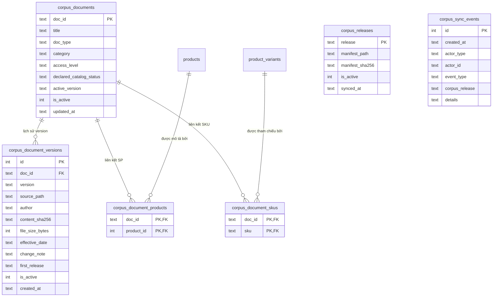

# Tài liệu Corpus Metadata & Đồng bộ SKU (TV1 — Database & Dữ liệu Nghiệp vụ)

Tài liệu đặc tả phần mở rộng cơ sở dữ liệu (SQLite schema v3), bộ tài liệu tri thức (`data_config/corpus/`), cấu trúc manifest phát hành (`v1.0`, `v1.1`), bộ kiểm tra đối soát SKU 5 lớp và các hàm dịch vụ Python do **TV1** cung cấp cho **TV2 (RAG)**, **TV3 (Backend/Router)**, **TV4 (Frontend)** và **TV5 (Evaluation)**.

---

## 1. Nguyên tắc kiến trúc & Ranh giới trách nhiệm

1. **Giữ nguyên 100% nền tảng đơn hàng & tồn kho cũ**: Không thay đổi schema v1–v2 (`products`, `product_variants`, `inventory`, `orders`, `order_items`, `audit_logs`, `conversations`, `conversation_messages`) và giữ nguyên **7 sản phẩm / 17 SKU** từ `database/shop_db/seed.py`.
2. **Hai nguồn chuẩn độc lập — đối soát hai chiều**:
   - **Manifest JSON** (`data_config/corpus_manifest_v1.0.json`, `v1.1.json`) là nguồn chuẩn duy nhất (*Single Source of Truth*) của metadata tài liệu RAG. Các bảng `corpus_*` trong SQLite chỉ là bản sao đã kiểm chứng, được nạp nguyên tử qua `sync_from_manifest()`.
   - **SQLite (`products`, `product_variants`, `inventory`)** là nguồn chuẩn duy nhất của trạng thái mở bán, giá hiện thời và số lượng tồn kho. Kết quả của RAG không bao giờ thay đổi đơn hàng, tồn kho hay giá.
3. **Bất biến phiên bản `(doc_id, version)`**: Một cặp `(doc_id, version)` đã đồng bộ vào SQLite không được phép thay đổi `content_sha256`. Mọi thay đổi nội dung (hoặc cập nhật bảng giá tham khảo khi DB đổi giá) bắt buộc phát hành `version` mới để citation luôn trỏ đúng nội dung.
4. **Chuẩn hóa đa nền tảng (Windows / Linux)**: Mọi file Markdown và manifest JSON dùng **UTF-8 không BOM**; hàm đọc chuẩn hóa `\r\n → \n` trước khi tính `content_sha256` và `file_size_bytes`.
5. **Điểm bàn giao cho TV2 & TV3**:
   - **Thư mục dữ liệu (`D7`)**: Đặt tại `data_config/` ở thư mục gốc dự án (mặc định đọc biến môi trường `CORPUS_MANIFEST_PATH`, fallback về `data_config/corpus_manifest_v1.0.json`).
   - **Helper phân quyền (`D6`)**: `corpus_service.py` cung cấp các hàm **chỉ-đọc (read-only)** lọc `access_level` ngay trong câu SQL để TV2 pre-filter trước khi xếp hạng vector và TV3 kiểm tra quyền/resolve citation.
   - **Khởi động runtime**: Backend hiện có gọi `migrate()` sẽ tự nâng DB lên schema v3 (bảng `corpus_*` rỗng). TV3 có thể gọi `ensure_corpus_seeded(conn)` khi khởi tạo ứng dụng nếu muốn tự nạp metadata `v1.0.0`.

---

## 2. Schema SQLite v3 (`003_corpus_metadata.sql`)

Migration `database/shop_db/migrations/003_corpus_metadata.sql` nâng `PRAGMA user_version` từ `2` lên `3`. Đầu file có các lệnh `DROP VIEW IF EXISTS` và `DROP TABLE IF EXISTS` cho các đối tượng `corpus_*` để tương thích hoàn toàn với `db.drop_all()` / `seed.reset_and_seed()` hiện hữu mà không chạm vào `db.py`.

### 2.1. Sơ đồ quan hệ phần mở rộng Corpus



### 2.2. Mô tả các bảng và VIEW

| Đối tượng | Ràng buộc chính | Mục đích |
|---|---|---|
| `corpus_releases` | PK `release`; partial UNIQUE index chỉ cho phép **tối đa 1** dòng `is_active = 1` | Quản lý phiên bản phát hành corpus hiện hành (`1.0.0`, `1.1.0`) |
| `corpus_documents` | PK `doc_id`; CHECK `doc_type`, `access_level`, `declared_catalog_status` | Danh mục tài liệu và phiên bản đang hoạt động (`active_version`) |
| `corpus_document_versions` | UNIQUE `(doc_id, version)`; partial UNIQUE index chỉ cho phép **1 version `is_active = 1` trên mỗi `doc_id`** | Lưu vết toàn bộ lịch sử phiên bản, đường dẫn, tác giả, SHA-256, `change_note` |
| `corpus_document_products` | PK `(doc_id, product_id)`, FK tới `products(id)` `ON DELETE CASCADE` | Liên kết nhiều-nhiều giữa tài liệu và sản phẩm |
| `corpus_document_skus` | PK `(doc_id, sku)`, FK tới `product_variants(sku)` `ON DELETE CASCADE` | Liên kết nhiều-nhiều giữa tài liệu và mã biến thể SKU |
| `corpus_sync_events` | Trigger chặn `UPDATE` và `DELETE` (append-only) | Nhật ký kiểm toán các lần `sync_applied` / `sync_rejected` (đã qua `audit_service.sanitize`, không lưu nội dung tài liệu) |
| `v_corpus_active_documents` | VIEW nối `corpus_documents` (`is_active=1`) và `corpus_document_versions` (`is_active=1`) | Nguồn truy vấn chuẩn cho các tài liệu đang có hiệu lực |
| `v_corpus_sku_status` | VIEW nối `corpus_document_skus`, `product_variants`, `products`, `corpus_documents` | Tính trực tiếp `live_sellable = (p.is_active = 1 AND pv.is_active = 1)`. Với `JKT-NVY-L` (`products.is_active = 0`, `product_variants.is_active = 1`), `live_sellable = 0` |

---

## 3. Phân quyền truy cập theo Role (`ROLE_ACCESS`)

Phân quyền được định nghĩa tập trung tại `shop_db.corpus_service.ROLE_ACCESS` và áp **ngay trong mệnh đề `WHERE access_level IN (...)` của SQL** trước khi dữ liệu rời tầng DB:

| Role đầu vào | Các `access_level` được phép | Phạm vi tài liệu |
|---|---|---|
| `public` | `('public',)` | Thông số sản phẩm (`DOC-PRD-*`), chính sách (`DOC-POL-*`), bảng size (`DOC-GDE-SIZE`), FAQ (`DOC-FAQ-PUBLIC`) |
| `customer` | `('public',)` | Giống `public` |
| `staff` | `('public', 'staff')` | Toàn bộ `public` + SOP hỗ trợ khách hàng, hạn mức hỗ trợ phí vận chuyển nội bộ, quy trình tồn kho/giá (`DOC-INT-*`) |
| `admin` | `('public', 'staff', 'admin')` | Toàn bộ `public` + `staff` + quy trình vận hành RAG release & chính sách ca trực/phụ cấp nội bộ (`DOC-ADM-*`) |

Role khác chuỗi trên (hoặc kiểu dữ liệu không phải `str`) sẽ bị chặn ngay với `CorpusValidationError`.

---

## 4. Danh mục 17 tài liệu Corpus & Cấu trúc Manifest

### 4.1. Danh sách tài liệu (`data_config/corpus/`)

Tổng cộng **17 `doc_id`** (tương ứng **18 file Markdown** do `DOC-POL-RETURN` có bản `v1.0` và `v1.1`), cung cấp **85 section `##`** ở release `1.0.0` (63 section `public`) và **86 section `##`** ở release `1.1.0` (64 section `public`):

| `doc_id` | Loại (`doc_type`) | Quyền | Trạng thái catalog | `product_ids` | `skus` | Đường dẫn (`data_config/corpus/...`) |
|---|---|---|---|---|---|---|
| `DOC-PRD-001` | `product_spec` | `public` | `active` | `[1]` | `TSH-BLK-M`, `TSH-BLK-L`, `TSH-WHT-M`, `TSH-WHT-L` | `products/prd_01_ao_thun_basic_cotton.md` |
| `DOC-PRD-002` | `product_spec` | `public` | `active` | `[2]` | `HOD-GRY-M`, `HOD-GRY-L`, `HOD-BLK-L` | `products/prd_02_ao_hoodie_ni.md` |
| `DOC-PRD-003` | `product_spec` | `public` | `active` | `[3]` | `SNK-WHT-40`, `SNK-WHT-41`, `SNK-WHT-42` | `products/prd_03_giay_sneaker_trang.md` |
| `DOC-PRD-004` | `product_spec` | `public` | `active` | `[4]` | `SLD-BLK-40`, `SLD-BLK-42` | `products/prd_04_dep_quai_ngang.md` |
| `DOC-PRD-005` | `product_spec` | `public` | `active` | `[5]` | `CAP-NVY-F`, `CAP-BLK-F` | `products/prd_05_non_luoi_trai.md` |
| `DOC-PRD-006` | `product_spec` | `public` | `active` | `[6]` | `BAG-GRY-15`, `BAG-BLK-15` | `products/prd_06_balo_laptop.md` |
| `DOC-PRD-007` | `product_spec` | `public` | `discontinued` | `[7]` | `JKT-NVY-L` | `products/prd_07_ao_khoac_du_ngung_ban.md` |
| `DOC-POL-RETURN` | `policy` | `public` | `not_applicable` | `[]` *(v1.0)* / `[5]` *(v1.1)* | `[]` *(v1.0)* / `CAP-NVY-F`, `CAP-BLK-F` *(v1.1)* | `policies/pol_doi_tra_huy_don_v1.0.md` & `_v1.1.md` |
| `DOC-POL-WARRANTY` | `policy` | `public` | `not_applicable` | `[3, 6]` | `SNK-WHT-40..42`, `BAG-GRY-15`, `BAG-BLK-15` | `policies/pol_bao_hanh.md` |
| `DOC-POL-SHIPPING` | `policy` | `public` | `not_applicable` | `[]` | `[]` | `policies/pol_giao_nhan_thanh_toan.md` |
| `DOC-GDE-SIZE` | `guide` | `public` | `not_applicable` | `[1,2,3,4,5,6]` | `[]` | `guides/gde_bang_size_tu_van.md` |
| `DOC-FAQ-PUBLIC` | `faq` | `public` | `not_applicable` | `[]` | `[]` | `guides/faq_khach_hang.md` |
| `DOC-INT-SOP-SUPPORT` | `sop_internal` | `staff` | `not_applicable` | `[]` | `[]` | `internal_staff/sop_xu_ly_khieu_nai_handoff.md` |
| `DOC-INT-PROMO-RULES` | `sop_internal` | `staff` | `not_applicable` | `[]` | `[]` | `internal_staff/sop_ho_tro_phi_va_uu_dai_noi_bo.md` |
| `DOC-INT-STOCK-OPS` | `sop_internal` | `staff` | `not_applicable` | `[7]` | `JKT-NVY-L` | `internal_staff/sop_van_hanh_ton_kho_gia.md` |
| `DOC-ADM-RAG-OPS` | `admin_ops` | `admin` | `not_applicable` | `[]` | `[]` | `internal_admin/adm_quan_tri_corpus_release.md` |
| `DOC-ADM-HR-POLICY` | `admin_ops` | `admin` | `not_applicable` | `[]` | `[]` | `internal_admin/adm_ca_truc_va_phu_cap.md` |

### 4.2. Quy ước Front Matter & Bảng biến thể

Mọi file `.md` mở đầu bằng khối front matter 7 khóa bắt buộc khớp với manifest:

```yaml
---
doc_id: DOC-PRD-001
title: Áo thun basic cotton — thông số, biến thể và bảo quản
version: 1.0
access_level: public
author: TV1 - Database & Business Data
effective_date: 2026-10-01
data_notice: Dữ liệu mô phỏng cho mini-project, không phải dữ liệu thật.
---
```

- Tài liệu `product_spec` có `catalog_status = "active"` bắt buộc có mục `## Biến thể và giá tham khảo` với bảng 4 cột `| SKU | Màu | Size | Giá tham khảo (VND) |`.
- Tài liệu `product_spec` có `catalog_status = "discontinued"` bắt buộc có mục `## Thông tin nhận diện sản phẩm` với bảng 4 cột `| SKU | Màu | Size | Trạng thái |` (`Ngừng bán`, không ghi giá).
- Cấm tuyệt đối việc ghi cứng số lượng tồn kho dạng số trong tài liệu.

### 4.3. Mẫu Manifest JSON

```json
{
  "manifest_schema_version": "1.0",
  "corpus_release": "1.0.0",
  "created_by": "TV1 - Database & Business Data",
  "catalog_source": "database/shop_db/seed.py",
  "documents": [
    {
      "doc_id": "DOC-PRD-001",
      "title": "Áo thun basic cotton — thông số, biến thể và bảo quản",
      "doc_type": "product_spec",
      "category": "Áo",
      "access_level": "public",
      "version": "1.0",
      "author": "TV1 - Database & Business Data",
      "source_path": "data_config/corpus/products/prd_01_ao_thun_basic_cotton.md",
      "effective_date": "2026-10-01",
      "encoding": "utf-8",
      "content_sha256": "<sha256 trên bytes LF>",
      "file_size_bytes": 3180,
      "catalog_status": "active",
      "product_ids": [1],
      "skus": ["TSH-BLK-M", "TSH-BLK-L", "TSH-WHT-M", "TSH-WHT-L"],
      "change_note": "Phát hành lần đầu."
    }
  ]
}
```

---

## 5. Tham chiếu API Python

Có thể import từ thư mục gốc dự án (`from database.shop_db import corpus_service, sku_sync_service, corpus_seed, corpus_files`) hoặc từ trong `database/` (`from shop_db import ...`).

### 5.1. `corpus_service.py` — Truy vấn read-only cho TV2, TV3, TV4

| Chữ ký hàm | Giá trị trả về / Hành vi |
|---|---|
| `allowed_access_levels(role: str) -> tuple[str, ...]` | Trả tuple mức quyền hợp lệ của `role`; raise `CorpusValidationError` nếu role lạ |
| `list_documents(conn, role, *, doc_type=None, category=None, product_id=None, sku=None) -> list[dict]` | Lọc tài liệu active ngay trong SQL theo `role` và bộ lọc tùy chọn (`sku` tự chuẩn hóa hoa/thường); mỗi phần tử kèm `product_ids: list[int]`, `skus: list[str]` |
| `check_document_access(conn, doc_id: str, role: str) -> dict` | Không raise lỗi nghiệp vụ; trả `{"allowed": bool, "reason": "ok" \| "not_found" \| "inactive" \| "access_denied"}`. Không trả tiêu đề/nội dung khi từ chối |
| `get_document(conn, doc_id: str, role: str) -> dict` | Trả metadata đầy đủ của 1 tài liệu active; raise `CorpusAccessDenied` hoặc `CorpusNotFound` |
| `resolve_citation(conn, doc_id: str, version: str \| None = None, role: str = "customer", repo_root=REPO_ROOT) -> dict` | Kiểm tra quyền, tra phiên bản (`None` = bản đang active) và xác minh file vật lý: trả `{"doc_id", "title", "source", "version", "access_level", "is_active_version", "source_exists", "sha256_matches"}` |
| `documents_for_sku(conn, sku: str, role: str = "customer") -> list[dict]` | Trả các tài liệu active liên kết trực tiếp với `sku` hoặc liên kết với `product_id` của `sku` (lọc theo `role`); raise `SkuNotFound` nếu mã SKU không có trong catalog |
| `list_versions(conn, doc_id: str, role: str = "admin") -> list[dict]` | Trả toàn bộ lịch sử phiên bản của `doc_id`; chỉ cho phép `role="admin"` (`CorpusAccessDenied` cho role khác) |
| `corpus_status(conn) -> dict` | Cho trang quản trị (TV3/TV4): trả `{"active_release", "manifest_path", "synced_at", "documents_by_access": {"public", "staff", "admin"}, "last_event"}` |

### 5.2. `sku_sync_service.py` — Kiểm tra Manifest & Đồng bộ SKU

| Chữ ký hàm | Giá trị trả về / Hành vi |
|---|---|
| `load_manifest(path) -> dict` | Đọc JSON UTF-8 không BOM, kiểm tra các trường khung ở cấp gốc; lỗi → `CorpusValidationError` |
| `validate_manifest(manifest: dict, repo_root=REPO_ROOT) -> dict` | Kiểm tra độc lập manifest và toàn bộ file Markdown (không cần SQLite — TV2 gọi được trước khi ingest). Trả `report` chuẩn |
| `verify_catalog_sync(conn, manifest: dict, repo_root=REPO_ROOT) -> dict` | Chạy `validate_manifest` rồi đối soát 2 chiều với bảng `products` và `product_variants` trong SQLite |
| `sync_from_manifest(conn, manifest_path=None, *, actor_type="system", actor_id="tv1-sync", repo_root=REPO_ROOT) -> dict` | Chạy `verify_catalog_sync`; nếu lỗi → ghi `sync_rejected` và raise `SkuSyncMismatch(report=...)` (không sửa dữ liệu corpus). Nếu đạt → cập nhật nguyên tử trong 1 transaction và ghi `sync_applied` |

Định dạng `report` trả về từ `validate_manifest` và `verify_catalog_sync`:

```python
{
    "ok": True,
    "corpus_release": "1.0.0",
    "errors":   [{"code": "...", "doc_id": "DOC-...", "sku": None, "detail": "..."}],
    "warnings": [{"code": "...", "doc_id": "DOC-...", "detail": "..."}],
    "stats":    {"documents": 17, "sections": 85, "public_sections": 63, "skus_linked": 17},
}
```

### 5.3. `corpus_files.py` & `corpus_seed.py`

- `corpus_files.read_normalized(path) -> tuple[str, bytes]`: Đọc file UTF-8 không BOM, chuẩn hóa LF.
- `corpus_files.fingerprint(path) -> dict`: Trả `{"content_sha256", "file_size_bytes"}`.
- `corpus_files.parse_front_matter(text)`, `section_titles(text)`, `find_sku_tokens(text)`, `parse_variant_table(text, heading)`, `find_hardcoded_stock(text)`.
- `corpus_seed.ensure_corpus_seeded(conn, manifest_path=None, repo_root=REPO_ROOT) -> dict`: Tự `migrate`, tự `seed_catalog` nếu bảng `products` trống, và `sync_from_manifest` nếu chưa có release active (gọi lặp lại an toàn).
- `corpus_seed.reset_and_seed_all(conn, manifest_path=None, repo_root=REPO_ROOT) -> dict`: Reset toàn bộ catalog + corpus và nạp sạch lại từ đầu.

---

## 6. Danh mục Exception & Mã lỗi đối soát

### 6.1. Exception (`corpus_errors.py`, kế thừa `DataServiceError`)

| Lớp Exception | `error.code` | Khi nào phát sinh |
|---|---|---|
| `CorpusValidationError` | `corpus_validation_error` | Sai tham số đầu vào (`role`, `doc_id`, `actor_type`) hoặc JSON manifest hỏng cấu trúc |
| `CorpusNotFound` | `corpus_doc_not_found` | Không tìm thấy `doc_id`, tài liệu đang inactive, hoặc không tìm thấy `version` |
| `CorpusFileIntegrityError` | `corpus_file_integrity_error` | File thiếu (`file_missing`), rỗng (`file_empty`), có BOM (`file_has_bom`), lỗi UTF-8 (`file_not_utf8`) |
| `SkuSyncMismatch` | `sku_sync_mismatch` | `sync_from_manifest` bị chặn do `verify_catalog_sync` có lỗi (`err.details["report"]` chứa chi tiết) |
| `CorpusAccessDenied` | `access_denied` | Role hiện tại không đủ quyền đọc tài liệu/citation/lịch sử version |
| `CorpusVersionConflict` | `corpus_version_conflict` | Cặp `(doc_id, version)` đã tồn tại trong DB với `content_sha256` khác |

### 6.2. Mã lỗi trong `report["errors"]`

- **Lớp tệp & cấu trúc manifest (`validate_manifest`)**: `missing_field`, `invalid_doc_id`, `duplicate_doc_id`, `invalid_enum`, `catalog_status_not_applicable`, `invalid_source_path`, `file_missing`, `file_empty`, `file_has_bom`, `file_not_utf8`, `hash_mismatch`, `size_mismatch`, `front_matter_mismatch`, `undeclared_sku_in_text`, `hardcoded_stock` (cảnh báo: `few_sections`, `low_public_sections`).
- **Lớp đối soát SQLite Catalog (`verify_catalog_sync`)**: `unknown_product_id`, `unknown_sku`, `sku_product_mismatch`, `product_spec_sku_set_mismatch`, `catalog_status_mismatch`, `product_name_missing`, `variant_table_missing`, `variant_table_mismatch`, `price_mismatch`, `missing_catalog_coverage`.

---

## 7. Lệnh CLI & Kịch bản Nâng cấp `1.0.0 → 1.1.0 → Rollback`

Chạy từ thư mục gốc dự án:

```bash
# 1. Kiểm tra toàn vẹn manifest + đối soát SKU (exit 0 nếu PASS, exit 1 nếu FAIL)
python -m database.shop_db.sku_sync_service --check --manifest data_config/corpus_manifest_v1.0.json
python -m database.shop_db.sku_sync_service --check --manifest data_config/corpus_manifest_v1.1.json

# 2. In SHA-256 & kích thước chuẩn hóa LF để cập nhật manifest khi phát hành version mới
python -m database.shop_db.sku_sync_service --fingerprints --manifest data_config/corpus_manifest_v1.0.json

# 3. Khởi tạo mới (hoặc reset sạch) catalog + corpus v1.0.0 trên một file DB cụ thể
python -m database.shop_db.corpus_seed --reset --db /tmp/shop_demo.db

# 4. Nâng cấp lên release 1.1.0 (DOC-POL-RETURN chuyển active_version từ 1.0 sang 1.1; bản 1.0 giữ trong lịch sử với is_active=0)
python -m database.shop_db.sku_sync_service --sync --db /tmp/shop_demo.db --manifest data_config/corpus_manifest_v1.1.json

# 5. Rollback về release 1.0.0 (kích hoạt lại DOC-POL-RETURN v1.0 nguyên tử, không sinh bản ghi trùng)
python -m database.shop_db.sku_sync_service --sync --db /tmp/shop_demo.db --manifest data_config/corpus_manifest_v1.0.json
```

> **Lưu ý cho TV2 khi nâng cấp / rollback**: Sau mỗi bước `--sync` chuyển đổi giữa `v1.0` và `v1.1`, TV2 cần chạy quy trình build/switch vector index bundle tương ứng với `corpus_release` đang active để index và DB luôn đồng bộ.

---

## 8. Bàn giao dữ liệu kiểm thử cho TV5 (Evaluation)

1. **Khác biệt nghiệp vụ giữa Release `1.0.0` và `1.1.0` (`DOC-POL-RETURN`)**:
   - **Thời hạn đổi size/màu do đổi ý**: ở `v1.0` là **7 ngày** kể từ ngày nhận hàng; lên `v1.1` nâng thành **14 ngày**.
   - **Ngoại lệ sản phẩm nón lưỡi trai**: ở `v1.0` chưa tách ngoại lệ riêng; lên `v1.1` bổ sung mục *Ngoại lệ đối với sản phẩm nón lưỡi trai* — hai mã `CAP-NVY-F` và `CAP-BLK-F` **không áp dụng đổi hàng do đổi ý** vì lý do vệ sinh (vẫn đổi trong 15 ngày nếu lỗi nhà sản xuất hoặc giao sai mã).
   - Các tài liệu `DOC-FAQ-PUBLIC` và `DOC-GDE-SIZE` chỉ dẫn chiếu sang `DOC-POL-RETURN` chứ không lặp lại số ngày đổi trả, đảm bảo không xảy ra mâu thuẫn chéo khi nâng lên `1.1.0`.
2. **Dữ liệu có sẵn cho các nhóm câu hỏi**:
   - **Exact / mã & con số**: 17 mã SKU (`TSH-BLK-M`, `HOD-BLK-L`, `SNK-WHT-41`, `BAG-GRY-15`, `JKT-NVY-L`...), bảo hành giày sneaker `6 tháng`, bảo hành balo laptop `12 tháng`, báo thiếu hàng trong `48 giờ`, đổi lỗi nhà sản xuất `15 ngày`, giặt áo thun tối đa `40°C`.
   - **Multi-condition / ngoại lệ**: Giày bị ngập nước không được bảo hành (`DOC-PRD-003` + `DOC-POL-WARRANTY`); áo/dép/nón không có bảo hành định kỳ nhưng vẫn đổi lỗi NSX theo `DOC-POL-RETURN`; sản phẩm ngừng bán `JKT-NVY-L` không nhận đơn mới (`DOC-PRD-007`); hủy/sửa đơn nháp `cart`/`pending_confirmation` so với đơn `confirmed`.
   - **Access-denied**: Khách hàng (`customer`) hỏi hạn mức hỗ trợ phí vận chuyển nội bộ `30.000 VND/đơn` (`DOC-INT-PROMO-RULES` — quyền `staff`), SLA nội bộ `4 giờ làm việc` (`DOC-INT-SOP-SUPPORT` — quyền `staff`), hoặc mức phụ cấp ca đêm `150.000 VND/ca` (`DOC-ADM-HR-POLICY` — quyền `admin`). Nhân viên (`staff`) hỏi chính sách phụ cấp ca trực hoặc quy trình rollback RAG (`DOC-ADM-*` — quyền `admin`).
3. **Danh sách chủ đề CỐ Ý VẮNG MẶT trong toàn bộ corpus (dành cho case `insufficient_evidence` / `no-evidence`)**:
   - Trả góp hoặc thanh toán bằng thẻ tín dụng / ví điện tử quốc tế.
   - Giao hàng quốc tế (ngoài lãnh thổ Việt Nam).
   - Giao hàng hỏa tốc cam kết nhận trong 2 giờ.
   - Chương trình tích điểm thành viên / hạng thẻ VIP.
   - Chương trình flash sale hoặc mã khuyến mãi công khai cho khách hàng.
   - Sản phẩm ngoài danh mục cửa hàng (ví dụ: quần jean, áo sơ mi, giày tây da thật, kính mát).

