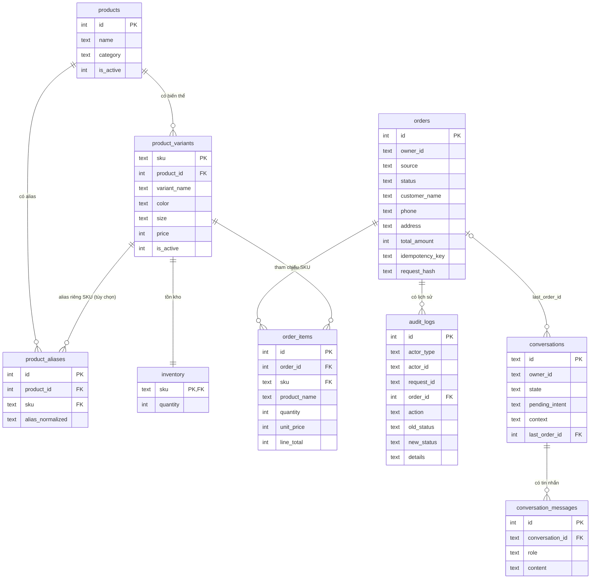

# Tài liệu Database (Vu - TV2)

SQLite, schema version 2 (`shop_db/schema.sql` là v1, `shop_db/migrations/002_*.sql` nâng lên v2; `migrate()` tự áp dụng theo thứ tự). Tiền tệ là VND (số nguyên), thời gian là UTC ISO-8601. Khóa ngoại được bật (`PRAGMA foreign_keys = ON`).

## 1. Sơ đồ quan hệ



## 2. Bảng và quyết định thiết kế

| Bảng | Khóa / ràng buộc chính | Ghi chú |
|---|---|---|
| `products` | PK `id`; `is_active` 0/1 | `is_active=0`: ngừng bán, ẩn khỏi catalog, không đặt được |
| `product_variants` | PK `sku`; FK `product_id`; `price >= 0` | SKU là định danh duy nhất cho mapping và đặt hàng |
| `inventory` | PK/FK `sku`; `quantity >= 0` | CHECK ngăn tồn kho âm ở mức DB |
| `product_aliases` | FK `product_id`, `sku` (có thể NULL) | `alias_normalized` đã bỏ dấu/hạ chữ; `sku` NULL = alias của cả sản phẩm |
| `orders` | PK `id`; `status` CHECK; UNIQUE một phần `(owner_id, idempotency_key)` | Giỏ hàng và đơn nháp dùng chung bảng, phân biệt bằng `status`. `request_hash` phát hiện cùng key nhưng nội dung khác |
| `order_items` | UNIQUE `(order_id, sku)`; FK `sku` | `unit_price`, `product_name`, `variant_name` là **snapshot** tại lúc backend xác nhận |
| `audit_logs` | FK `order_id`; trigger chặn UPDATE/DELETE | Append-only; `details` là JSON đã lọc dữ liệu nhạy cảm |
| `conversations` | PK `id` (uuid); FK `last_order_id` | `context` JSON tối đa 8 KB; `state`, `pending_intent` do workflow đặt |
| `conversation_messages` | FK `conversation_id` ON DELETE CASCADE; `role` CHECK | Giữ tối đa 200 tin gần nhất mỗi hội thoại, mỗi tin tối đa 2000 ký tự |

**Vòng đời đơn** (`status_service.ALLOWED_TRANSITIONS`):

```
cart ──► pending_confirmation ──► confirmed
  │              │                    │
  └──────────────┴────────────────────┴──► cancelled
```

- Chỉ `cart` và `pending_confirmation` được sửa item/giao nhận.
- Chuyển sang `pending_confirmation`: bắt buộc đủ tên/SĐT/địa chỉ, có ít nhất 1 dòng, đủ tồn kho; giá snapshot được cập nhật theo giá hiện tại.
- Chuyển sang `confirmed`: kiểm tra lại tồn kho, **trừ kho** (UPDATE có điều kiện `quantity >= n`, nên hai đơn tranh nhau hàng thì đơn sau thất bại và rollback). Nếu giá đã đổi so với snapshot thì báo `price_changed`; gọi `refresh_prices` để khách xem lại giá mới rồi confirm lại.
- Hủy đơn đã `confirmed`: **hoàn kho**. Đơn nháp chưa giữ hàng.

**Chống tạo đơn trùng:** `create_cart` và `create_draft_order` nhận `idempotency_key`. Trong cùng transaction `BEGIN IMMEDIATE`, service tra `(owner_id, key)`: chưa có thì tạo đơn và lưu key cùng `request_hash`; đã có và hash giống thì trả đơn cũ (`replayed=True`, ghi audit `duplicate_request_ignored`); hash khác thì báo `idempotency_conflict`. Lần gọi thất bại không "đốt" key (rollback). UNIQUE index là lớp chặn cuối cùng. Cách đặt key cho từng luồng cần thống nhất với Minh: gợi ý web = mã sinh khi mở form checkout, chat = `f"{conversation_id}:{message_id}"`.

## 3. Service (tham chiếu nhanh)

| Hàm | Mục đích |
|---|---|
| `catalog.search_products(conn, query, category=None, limit=5)` | Tìm theo tên/alias/SKU, không phân biệt dấu; trả `score`, `matched_skus` |
| `catalog.resolve_product(conn, query)` | `status`: `matched` (có `sku`) / `ambiguous` (`reason`: `multiple_products`, `variant_unspecified`, `variant_ambiguous`, kèm `candidates`) / `no_match` |
| `catalog.get_product / get_variant / get_price / get_stock` | Đọc chi tiết; raise `ProductNotFound`/`SkuNotFound` |
| `catalog.list_products / list_categories` | Cho API catalog |
| `catalog.check_availability(conn, sku, qty)` | Không raise; `reason`: `ok`, `invalid_quantity`, `sku_not_found`, `out_of_stock`, `insufficient_stock` |
| `catalog.check_items(conn, items)` | Kiểm tra nhiều dòng, gộp trùng SKU, tính tổng |
| `orders.create_cart / create_draft_order` | Tạo giỏ / đơn nháp hoàn chỉnh trong 1 transaction, hỗ trợ `idempotency_key` |
| `orders.add_item / set_item_quantity / remove_item` | Sửa dòng đơn, kiểm tra tồn kho, tính lại tổng |
| `orders.update_delivery / submit_order / refresh_prices` | Giao nhận, gửi đơn, cập nhật giá |
| `orders.get_order / list_orders / get_latest_order` | Đọc đơn (`get_latest_order` cho "đơn lúc nãy") |
| `status_service.change_status(conn, ctx, order_id, new_status, reason=None)` | Chuyển trạng thái + trừ/hoàn kho + audit |
| `conv.get_or_create_conversation / get_conversation / get_latest_conversation` | Mở hoặc lấy phiên hội thoại |
| `conv.update_conversation(conn, id, merge=..., context=..., state=..., pending_intent=..., last_order_id=...)` | Cập nhật nguyên tử ngữ cảnh; `merge` gộp nông, giá trị `None` xóa key |
| `conv.add_message / get_messages / reset_conversation` | Lưu và đọc tin nhắn; xóa ngữ cảnh đang xử lý |
| `audit_service.log_event / list_events / sanitize` | Ghi và đọc lịch sử |

**Lọc dữ liệu nhạy cảm trong audit:** key `password`, `token`, `secret`, `api_key`, `authorization`, `cookie`, `session_id`, `address`, `customer_name`, `email`... → `[REDACTED]`; số điện thoại → `***678`; chuỗi dài bị cắt 200 ký tự. Audit của thao tác giao nhận chỉ ghi **tên trường đổi**, không ghi giá trị.

## 4. Dữ liệu seed và hướng dẫn reset

17 SKU của 7 sản phẩm, 3 nhóm (Áo, Giày, Phụ kiện). Có 4 SKU hết hàng (`TSH-WHT-M`, `HOD-BLK-L`, `SNK-WHT-42`, `BAG-BLK-15`), tồn thấp để test (`SNK-WHT-41` còn 2, `HOD-GRY-L` còn 3), và 1 sản phẩm ngừng bán (`JKT-NVY-L`).

```bash
python -m shop_db.seed --reset              # xóa sạch, tạo lại schema + migration, nạp dữ liệu demo
python -m shop_db.seed                      # chỉ nạp nếu DB đang trống
python -m shop_db.seed --reset --db demo.db # dùng file DB khác (hoặc đặt biến SHOP_DB_PATH)
```

Thêm migration mới: tạo `shop_db/migrations/003_ten.sql` (tên bắt đầu bằng số version), `migrate()` sẽ tự áp dụng khi chạy.

## 5. Kết quả kiểm thử (79 test, `python -m unittest discover -s tests`)

| Nhóm | File | Số test | Nội dung chính |
|---|---|---|---|
| Migration/seed trên DB mới | `test_schema_seed.py` | 6 | Tạo đủ bảng, seed ≥10 SKU/≥3 nhóm, reset lặp lại được, migrate idempotent, DB file mới |
| Catalog/inventory | `test_catalog.py` | 10 | Tìm không dấu/alias/màu-size/SKU, ẩn sản phẩm ngừng bán, giá/tồn, `check_availability` mọi `reason` |
| Kết quả không khớp / nhiều khớp | `test_resolve.py` | 8 | `matched`, `variant_unspecified`, `variant_ambiguous`, `multiple_products`, `no_match`, input rác |
| **1. Không đủ tồn kho** | `test_group1_stock.py` | 7 | Hết/thiếu hàng khi tạo, thêm, sửa; tranh hàng giữa 2 đơn; confirm nhiều dòng rollback; trừ/hoàn kho |
| **2. SKU/biến thể không tồn tại** | `test_group2_sku.py` | 7 | SKU sai, SQL injection, SKU ngừng bán, rollback khi 1 dòng sai, input sai kiểu/số lượng |
| **3. Snapshot giá và audit** | `test_group3_snapshot_audit.py` | 10 | Snapshot giữ nguyên khi đổi giá/tên, `price_changed`, chuỗi audit đủ vòng đời, không lộ SĐT/địa chỉ, audit append-only |
| Chống tạo đơn trùng | `test_idempotency.py` | 10 | Bấm gửi 2 lần, khác nội dung → conflict, key theo owner, lần lỗi không đốt key, 6 luồng song song chỉ ra 1 đơn |
| Hội thoại theo phiên | `test_conversation.py` | 8 | Gộp context qua nhiều lượt, validate, cắt/prune tin nhắn, cách ly giữa các phiên, còn nguyên sau khi mở kết nối mới |
| Quan hệ bảng, transaction, migration | `test_relations.py` | 13 | FK/CHECK/UNIQUE/CASCADE, rollback khi audit lỗi giữa chừng, transaction lồng, cô lập giữa 2 kết nối, nâng cấp v1→v2 giữ dữ liệu |

Kết quả lần chạy cuối: `Ran 79 tests ... OK`.

Lỗi đã sửa trong lúc test:
1. Truy vấn "áo khoác dù" (sản phẩm ngừng bán) từng khớp nhầm theo nhóm "Áo". Hiện nhóm chỉ khớp khi câu hỏi đúng bằng tên nhóm.
2. Truy vấn "áo thun" từng bị `resolve_product` coi là đã khớp thẳng `TSH-BLK-M`, vì alias riêng của SKU đó ("áo thun đen m") chứa cụm "áo thun". Hiện alias/SKU chỉ được tính khi câu hỏi chứa đủ alias đó.

## 6. Kịch bản demo phần dữ liệu (~3 phút)

Chạy `python demo.py`, nói theo 11 bước:

1. Reset + seed DB mới bằng một lệnh.
2. Tìm "áo thun đen size M" (không dấu, alias, màu/size) → ra đúng `TSH-BLK-M`.
3. Tra giá/tồn kho, kiểm tra số lượng: đủ hàng / hết hàng / thiếu hàng / SKU lạ.
4. Tạo đơn nháp: tổng tiền do server tính, SĐT chuẩn hóa.
5. Đặt quá tồn kho → lỗi `insufficient_stock` và **không để lại đơn rác** (rollback).
6. Đổi giá sau khi lên đơn → snapshot giữ nguyên, confirm báo `price_changed`.
7. Confirm → trừ kho cùng transaction.
8. Mở audit log: đủ actor/request/chuyển trạng thái, không lộ dữ liệu cá nhân.
9. `resolve_product`: một SKU rõ ràng / còn mơ hồ (hỏi lại) / không khớp.
10. Hội thoại: lưu ngữ cảnh qua nhiều lượt, biết còn thiếu gì để hỏi bổ sung.
11. Gửi cùng yêu cầu 2 lần → chỉ 1 đơn (`replayed=True`).

## 7. Câu hỏi viva dự kiến

- **Vì sao snapshot giá trong `order_items`?** Đổi giá catalog sau này không làm sai đơn cũ; khách thấy đúng giá đã được backend xác nhận.
- **Vì sao trừ kho lúc confirm chứ không lúc tạo đơn nháp?** Đơn nháp có thể bị bỏ dở; trừ sớm sẽ khóa hàng vô ích. Tranh chấp được xử lý bằng UPDATE có điều kiện trong transaction.
- **Hai khách cùng mua món cuối thì sao?** `BEGIN IMMEDIATE` + `UPDATE ... WHERE quantity >= n`: đơn đến sau nhận `insufficient_stock` và rollback.
- **Chống tạo đơn trùng thế nào, nếu 2 request đến cùng lúc?** `BEGIN IMMEDIATE` xếp hàng các request ghi; request sau thấy key đã có và trả đơn cũ. UNIQUE index chặn nếu có đường ghi nào bỏ qua service. Có test 6 luồng song song.
- **Vì sao lưu `request_hash`?** Cùng key nhưng nội dung khác là lỗi của client (dùng lại key sai), nên báo conflict thay vì lặng lẽ trả đơn không khớp yêu cầu.
- **Vì sao audit không lưu địa chỉ/SĐT?** Giảm rò rỉ dữ liệu cá nhân; chỉ cần biết trường nào đã đổi. Trigger chặn sửa/xóa để lịch sử đáng tin. Dữ liệu giao nhận chỉ nằm ở `orders` và `conversations.context` (khi chat đang thu thập).
- **Chống SQL injection thế nào?** Mọi giá trị dùng tham số `?`; tên cột trong `UPDATE` chỉ lấy từ whitelist đã validate.
