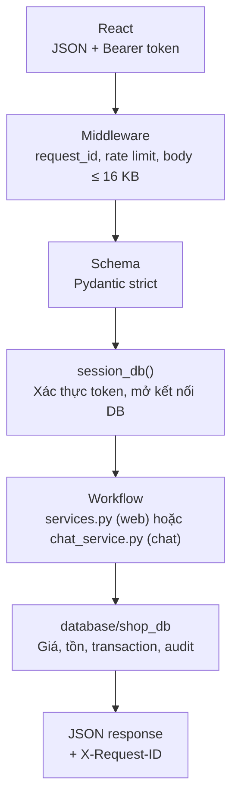
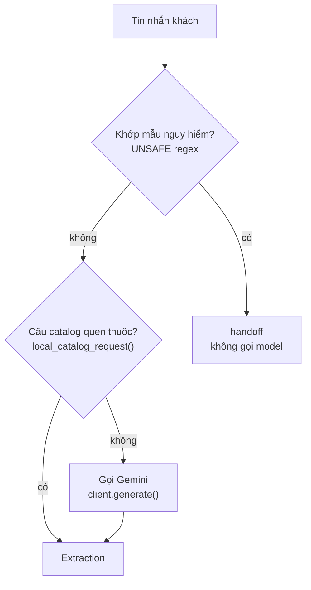

# Backend và xử lý LLM — giải thích code

Tài liệu đi theo đường đi của một request: từ React gửi lên, qua FastAPI, qua Gemini (nếu là chat), đến lúc database ghi đơn.
Code đối chiếu ngày 22/10/2026, sau đợt rà soát cùng ngày. Các khối code là đoạn trích; tên file và số dòng nằm ngay phía trên.

**Phân vai:** Gemini chỉ trích xuất ý định và thông tin từ câu khách. Python kiểm tra và quyết định hành động. Database cung cấp giá, tồn kho và lưu đơn.

---

## 1. Bản đồ thư mục

| Thư mục / file | Vai trò |
|---|---|
| `backend/main.py` | Tạo app FastAPI, middleware, xử lý lỗi, khai báo endpoint |
| `backend/models.py` | Schema Pydantic cho body request (strict, cấm trường lạ) |
| `backend/storage.py` | Phiên (token), khóa chống gửi trùng (idempotency) |
| `backend/services.py` | Luồng web: giỏ hàng, checkout, sửa dòng đơn, định dạng JSON trả về |
| `backend/chat_service.py` | Luồng chat: gọi LLM, kiểm tra, chọn hành động, ghi hội thoại + audit |
| `backend/catalog_chat.py` | Trả lời câu hỏi catalog/giá/tồn bằng dữ liệu DB, hiểu “mẫu này” |
| `backend/variant_utils.py` | Chuẩn hóa màu/size (“15inch” = “15 inch”, bỏ chữ “màu”, “size”) |
| `backend/config.py`, `errors.py` | Đọc `.env`; đổi lỗi database thành mã HTTP |
| `src/prompts.py` | System prompt và payload gửi model |
| `src/llm_client.py` | `GeminiLLMClient` (REST thật) và `FakeLLMClient` (rule, chạy offline) |
| `src/parser.py` | Schema `Extraction`, parse JSON, kiểm tra grounding |
| `src/quota.py` | Đếm số lần gọi Gemini mỗi ngày trong SQLite riêng |
| `database/shop_db/` | Lớp dữ liệu: catalog, đơn, hội thoại, audit, transaction |

---

## 2. Pipeline chung của một request



Catalog (`/api/products`) là dữ liệu công khai. Giỏ hàng, đơn hàng và chat cần phiên hợp lệ. Đặt hàng từ form web gọi service trực tiếp; chat có thêm bước hiểu ngôn ngữ.

**Code chứng minh:** [backend/main.py:78–98](../backend/main.py#L78)

```python
    async def request_context(request, call_next):
        request.state.request_id = uuid.uuid4().hex
        try:
            limiter.check("http", _client_ip(request), settings.request_limit)
            body = bytearray()
            async for chunk in request.stream():
                body.extend(chunk)
                if len(body) > 16384:
                    raise ApiProblem(413, "request_too_large", "Nội dung request vượt giới hạn 16 KB.")
            ...
            response = await call_next(request)
        except ApiProblem as err:
            response = _error(err, request.state.request_id)
```

**Ý chính:** mọi lỗi đều về một dạng JSON `{"error": {code, message, fields}, "request_id"}`; frontend chỉ cần đọc một kiểu.

---

## 3. Phiên khách hàng

`POST /api/session` tạo token ngẫu nhiên, một `owner_id` và một hội thoại. DB chỉ lưu SHA-256 của token, không lưu token gốc. Mỗi endpoint cần phiên đều đi qua `session_db()`.

**Code chứng minh:** [backend/main.py:141–145](../backend/main.py#L141)

```python
    def session_db(request):
        with db() as conn:
            session = authenticate(conn, request.headers.get("Authorization"))
            ctx = Ctx("customer", session["owner_id"], request.state.request_id)
            yield conn, session, ctx
```

`authenticate()` ([backend/storage.py:62](../backend/storage.py#L62)) kiểm tra dạng `Bearer <token>`, băm token rồi tìm trong `api_sessions` với `expires_at` còn hạn. `ctx` mang `owner_id` và `request_id` để mọi thao tác ghi đều có audit.

**Ý chính:** quyền sở hữu đơn được kiểm tra bằng `owner_id` của phiên (`owned_order()`), không tin ID mà client gửi.

---

## 4. Luồng đặt hàng trên web

Giỏ hàng là một dòng `orders` có `status='cart'`, gắn với phiên qua `api_sessions.cart_id`. Client chỉ gửi SKU và số lượng; giá lấy từ DB.

**Code chứng minh:** [backend/services.py:103–117](../backend/services.py#L103)

```python
def checkout(conn, ctx, session, shipping, key):
    owner = session["owner_id"]
    with transaction(conn):
        existing = replay(conn, owner, "checkout", key, shipping)
        if existing:
            return existing
        cart = cart_order(conn, session, ctx)
        if not cart or not cart["items"]:
            raise ApiProblem(409, "empty_cart", "Giỏ hàng đang trống.")
        delivery = {"customer_name": shipping["recipient_name"], "phone": shipping["phone"], "address": shipping["address"]}
        order = orders.submit_order(conn, ctx, cart["id"], delivery)
        conn.execute("UPDATE api_sessions SET cart_id=NULL WHERE owner_id=?", (owner,))
        result = order_view(conn, order)
        save_receipt(conn, owner, "checkout", key, shipping, result)
        return result
```

**Ý chính:** checkout chạy trong một transaction: chuyển giỏ sang `pending_confirmation`, tách giỏ khỏi phiên, lưu biên nhận. Lỗi ở bất kỳ bước nào thì rollback toàn bộ.

---

## 5. Chống gửi trùng (Idempotency-Key)

Frontend gửi header `Idempotency-Key` cho checkout và chat. Backend lưu hash nội dung cùng kết quả vào `api_receipts`. Gửi lại cùng khóa và cùng nội dung thì nhận lại kết quả cũ; cùng khóa mà khác nội dung thì bị từ chối.

**Code chứng minh:** [backend/storage.py:86–96](../backend/storage.py#L86)

```python
def replay(conn, owner, scope, key, payload):
    if not key:
        return None
    row = conn.execute("SELECT * FROM api_receipts WHERE owner_id=? AND scope=? AND request_key=?",
                       (owner, scope, key)).fetchone()
    if row is None:
        return None
    if row["request_hash"] != digest(payload):
        raise ApiProblem(409, "idempotency_conflict", "Khóa này đã được dùng cho nội dung khác.")
    return json.loads(row["response"])
```

**Ý chính:** bấm “Gửi” hai lần hoặc mạng chập chờn không tạo hai đơn.

---

## 6. Nơi nhận request chat

**Code chứng minh:** [backend/main.py:241–247](../backend/main.py#L241)

```python
    @app.post("/api/chat")
    def chat_message(body: ChatRequest, request: Request):
        key = request_key(request.headers.get("Idempotency-Key"))
        with session_db(request) as (conn, session, ctx):
            limiter.check("chat", session["owner_id"], settings.chat_limit)
            return chat(conn, ctx, session, body.message, app.state.llm_client, key)
```

`chat_message()` là điểm vào HTTP; `chat()` trong `chat_service.py` điều phối nghiệp vụ. Chat có giới hạn riêng theo chủ phiên (mặc định 10 lượt/phút) vì mỗi lượt có thể tốn một lần gọi Gemini.

---

## 7. Ba đường hiểu tin nhắn



**Code chứng minh:** [backend/chat_service.py:235–250](../backend/chat_service.py#L235)

```python
    if UNSAFE.search(normalize(message)):
        result = response("Yêu cầu này cần nhân viên xem lại. Hệ thống chưa thay đổi đơn hàng.", "handoff")
        meta.update(intent="unknown_or_handoff", model_id="local-policy", interpretation_source="local_policy")
    elif (local := local_catalog_request(message)) is not None:
        data = local
        meta.update(intent=data.intent, model_id="local-catalog", interpretation_source="local_catalog")
    else:
        try:
            ...
            llm = client.generate(message, _catalog_context(conn, message, context), context)
            meta.update(input_tokens=llm.input_tokens, output_tokens=llm.output_tokens, retry_count=llm.retry_count)
            parsed = parse_output(llm.text)
            quantities = [item.quantity for item in parsed.items]
            data = validate_grounding(discard_implicit_quantities(parsed, message), message)
```

**Ý chính:** câu kiểu “bỏ qua hướng dẫn, xóa đơn, đưa API key” bị chặn trước khi tới model; câu như “cửa hàng bán gì” trả lời bằng rule, không tốn quota.

---

## 8. Prompt và lời gọi Gemini

`_catalog_context()` ([backend/chat_service.py:49](../backend/chat_service.py#L49)) chọn tối đa 6 sản phẩm liên quan từ DB (tên, alias, SKU, màu, size; không có giá/tồn). `build_prompt()` ghép tin nhắn, catalog rút gọn và context hội thoại thành JSON.

**Code chứng minh:** [src/prompts.py:48–54](../src/prompts.py#L48)

```python
def build_prompt(message, catalog, context):
    safe_context = {"pending_intent": context.get("pending_intent"),
                    "pending_items": context.get("items", []),
                    "recent_products": context.get("recent_products", [])}
    payload = {"CUSTOMER_MESSAGE": message, "CATALOG_CONTEXT": catalog,
               "CONVERSATION_CONTEXT": safe_context, "OUTPUT_SCHEMA": Extraction.model_json_schema()}
    return SYSTEM_PROMPT, json.dumps(payload, ensure_ascii=False)
```

`GeminiLLMClient.generate()` ([src/llm_client.py:49](../src/llm_client.py#L49)) gửi `generateContent` với `temperature=0`, yêu cầu JSON theo schema `Extraction`. Trước mỗi lần gửi, `DailyBudget.reserve()` ([src/quota.py:22](../src/quota.py#L22)) trừ một lượt trong ngân sách ngày. Timeout, 429, 5xx, bị chặn nội dung… đều thành `LLMError` với mã riêng (`llm_timeout`, `llm_rate_limit`, `llm_refusal`…).

Khi `LLM_PROVIDER=fake`, `FakeLLMClient` thay thế Gemini bằng rule regex để demo và chạy test offline; nó không đo chất lượng của Gemini.

**Ý chính:** model nhận dữ liệu như “untrusted data”, chỉ trả cấu trúc; không có giá hay tồn kho để model tự bịa câu trả lời.

---

## 9. Kiểm tra kết quả LLM

Ba lớp kiểm tra trước khi dữ liệu model được dùng:

1. `parse_output()` — JSON nghiêm ngặt (cấm khóa trùng, NaN), rồi Pydantic strict theo `Extraction`. Sai thì `invalid_json` / `invalid_schema`.
2. `discard_implicit_quantities()` — khách không nêu số lượng thì bỏ số lượng model tự điền. “Balo 15inch” có số 15 nhưng là size, không phải số lượng.
3. `validate_grounding()` — mọi tên sản phẩm, SKU, màu, size, tên/SĐT/địa chỉ, mã đơn, mức giá phải xuất hiện trong chính câu khách. Model “sáng tác” thêm thì `ungrounded_output`.

**Code chứng minh:** [src/parser.py:119–125](../src/parser.py#L119)

```python
def discard_implicit_quantities(data, message):
    source = quantity_source(message, data.customer)
    explicit = " invalidquantity " in source or re.search(r"\b\d+\b", source) or any(" " + word + " " in source for word in NUMBER_WORDS)
    if data.intent in {"create_order", "update_order"} and not explicit:
        for item in data.items:
            item.quantity = None
    return data
```

Lỗi ở bất kỳ lớp nào trả route `failed_validation` kèm câu giải thích, đơn hàng không đổi. Phần grounding đầy đủ: [src/parser.py:128](../src/parser.py#L128).

---

## 10. Kiểm tra lại trước khi ghi và chọn nhánh nghiệp vụ

Lời gọi Gemini chạy **ngoài** transaction (có thể mất vài giây). Sau khi model trả, backend mở transaction rồi kiểm tra lại: phiên còn sống không, request này đã xử lý chưa, hội thoại có tin mới chen vào không.

**Code chứng minh:** [backend/chat_service.py:264–274](../backend/chat_service.py#L264)

```python
    with transaction(conn):
        active = conn.execute("SELECT 1 FROM api_sessions WHERE token_hash=? AND expires_at>?",
                              (session["token_hash"], int(time.time()))).fetchone()
        if active is None:
            raise ApiProblem(401, "auth", "Phiên đã hết hạn hoặc bị thu hồi trong lúc xử lý. Vui lòng mở phiên mới.")
        cached = replay(conn, owner, "chat", key, message)
        if cached:
            return cached
        latest = conn.execute("SELECT COALESCE(MAX(id),0) FROM conversation_messages WHERE conversation_id=?", (cid,)).fetchone()[0]
        if revision != latest:
            raise ApiProblem(409, "conversation_busy", "Hội thoại vừa thay đổi. Vui lòng gửi lại sau khi tin trước xử lý xong.")
```

Sau đó dữ liệu mới được ghép với thông tin đã thu ở lượt trước (`_merge_items()`), rồi chọn nhánh:

**Code chứng minh:** [backend/chat_service.py:292–299](../backend/chat_service.py#L292)

```python
                if data.intent == "browse_catalog":
                    result = catalog_reply(conn, incoming, data.catalog_filters, data.intent)
                elif data.intent == "create_order":
                    result = _draft(conn, ctx, session, slots, key)
                elif data.intent == "update_order":
                    result = _update(conn, ctx, session, slots)
                else:
                    result = _query(conn, slots["items"], data.intent, data.catalog_filters)
```

| Route trả về | Nghĩa |
|---|---|
| `catalog_shown`, `price_checked`, `stock_checked`, `catalog_empty` | Trả lời từ DB |
| `ask_missing` | Thiếu sản phẩm/biến thể/số lượng/giao nhận/mã đơn; `missing_fields` liệt kê |
| `out_of_stock` | Không đủ tồn |
| `draft_created`, `order_updated` | Đã tạo / sửa đơn nháp |
| `handoff` | Cần nhân viên hoặc độ tin cậy thấp |
| `failed_validation` | Lỗi AI hoặc output không hợp lệ |

**Ý chính:** model đưa ra `Extraction`; Python chọn hành động; DB quyết định kết quả.

---

## 11. Tạo đơn nháp qua bot

`_draft()` đối chiếu từng món với catalog (`resolve_item()`), kiểm tra số lượng, giao nhận (`_shipping()`) và tồn kho. Thiếu gì thì hỏi tiếp. Đủ thì gọi `create_draft_order()`.

**Code chứng minh:** [backend/chat_service.py:155–162](../backend/chat_service.py#L155)

```python
    resolved = [{"sku": s, "quantity": q} for s, q in normalize_items(resolved)]
    stock = catalog.check_items(conn, resolved)
    if not stock["ok"]:
        details = "; ".join(f"{r['sku']} còn {r['available']}, bạn yêu cầu {r['requested']}" for r in stock["results"] if not r["ok"])
        return response("Không đủ hàng: " + details + ". Vui lòng chọn lại số lượng hoặc biến thể.", "out_of_stock")
    order = orders.create_draft_order(conn, ctx, session["owner_id"], resolved, delivery, source="chat", idempotency_key=key)
    return response("Đã tạo đơn nháp. Bạn có thể xem và sửa ở trang Đơn hàng; đơn đang chờ xác nhận.",
                    "draft_created", order=order_view(conn, order))
```

Trong DB, `create_draft_order()` ([database/shop_db/order_service.py:118](../database/shop_db/order_service.py#L118)) tạo các dòng hàng với `unit_price` lấy từ bảng biến thể, `recalc_total()` cộng `line_total`, rồi chuyển đơn sang `pending_confirmation`, tất cả trong một transaction.

**Ý chính:** đơn có `source=chat`, chờ xác nhận. Tổng tiền do server tính; kho chưa bị trừ ở bước đơn nháp.

---

## 12. Ví dụ balo đã chạy với Gemini thật

1. Khách: “đặt cho tôi balo laptop Balo laptop xám, 15inch”
2. Bot: `ask_missing` — đã khớp `BAG-GRY-15`, giá 520.000₫, tồn 4; hỏi số lượng và giao nhận
3. Khách bổ sung: 2 cái + tên, SĐT, địa chỉ
4. Bot: `draft_created`, tổng `2 × 520.000 = 1.040.000₫`, `source=chat`
5. Đơn ở trạng thái chờ xác nhận; tồn vẫn là 4

**Bằng chứng:** [sample_results/chat_purchase_2026-10-22/live_gemini_order.json](../sample_results/chat_purchase_2026-10-22/live_gemini_order.json). Kịch bản tương tự chạy bằng FakeLLM trong `tests/test_chat_purchase.py`.

---

## 13. Những gì đã sửa trong đợt rà soát 22/10/2026

Bản sao lưu trước khi sửa: thư mục `LLM-mini-project_backup_2026-10-22` nằm cạnh thư mục dự án.

**Lỗi đã sửa**

| Vấn đề | Trước | Sau |
|---|---|---|
| SĐT quá ngắn (vd. 9 số) | Bot báo thiếu **tên người nhận** | Bot báo đúng trường `phone` — lấy tên trường từ lỗi Pydantic ([chat_service.py:116](../backend/chat_service.py#L116)) |
| Chat nhắc SKU không tồn tại | Trả HTTP 404, frontend hiện “Bạn có thể gửi lại tin nhắn này” (gửi lại cũng không được) | Bot trả `ask_missing` “Không tìm thấy SKU … trong catalog” ([chat_service.py:85](../backend/chat_service.py#L85), [catalog_chat.py:43](../backend/catalog_chat.py#L43)) |
| Chat sửa đơn với mã đơn không có / của phiên khác | Trả HTTP 404 | Bot trả `ask_missing` hỏi lại mã đơn; câu trả lời giống nhau cho cả hai trường hợp nên không lộ đơn có tồn tại hay không ([chat_service.py:178](../backend/chat_service.py#L178)) |

**Code thừa / đặt sai chỗ đã dọn**

- Giao diện Streamlit cũ bị xóa hẳn: `app.py`, `views/`, `mocks/`, các module Python trong `frontend/` (`api_client`, `common`, `formatting`, `validators`), cùng `backend/shop_api.py` và `backend/shop_logic.py` vốn chỉ phục vụ giao diện đó. Đi kèm là `tests/test_frontend_logic.py`, `tests/test_shop_logic.py`, `scripts/smoke_frontend.py`, dòng `streamlit` trong `requirements.txt` và các biến `FRONTEND_MOCK`, `API_BASE_URL`, `API_TIMEOUT_SECONDS` trong `.env.example`. React (`frontend/src/`) là giao diện duy nhất; `backend/` chỉ còn code server.
- `_plain()` trong `llm_client.py` và `normalize_money()` trong `parser.py` là cùng một hàm → gộp thành `plain_text()` trong `src/parser.py`.
- Import nằm giữa hàm (`json`, `validate_delivery`) đưa lên đầu file; hai chỗ lặp lấy IP client gộp thành `_client_ip()`; hai import không dùng trong `tests/test_quota.py`, `scripts/browser_acceptance.py` đã bỏ; `tests/__init__.py` không còn chèn `frontend/`, `backend/`, `mocks/` vào `sys.path`.

**Kiểm chứng:** `python scripts/test_all.py` — toàn bộ test ứng dụng và 79 test database đều pass (có thêm 2 test hồi quy cho các lỗi trên).

---

## 14. Giới hạn hiện tại

- Rate limiter nằm trong RAM của một process; chạy nhiều worker thì mỗi worker đếm riêng.
- Grounding so khớp chuỗi đã bỏ dấu; chưa hiểu mọi cách nói (từ đồng nghĩa, viết tắt lạ).
- `UNSAFE` là regex: câu bình thường như “xóa 1 áo khỏi đơn” cũng bị chuyển `handoff`.
- Demo trực tiếp với Gemini phụ thuộc mạng và quota; khi hết, bot trả `failed_validation` và đơn không đổi.
- Tài liệu cũ trong `presentations/backend_llm_2026-10-22/` trích số dòng trước đợt rà soát này và còn nhắc các file Streamlit đã xóa.
