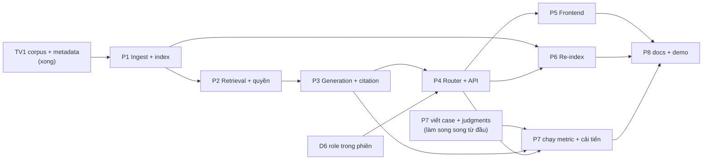

# Kế hoạch mở rộng RAG

> **Trạng thái 29/10/2026:** P1–P8 đã triển khai theo kế hoạch này với các quyết định D1–D8 như đề xuất. Kết quả: [README](../README.md#rag-tra-cứu-tài-liệu-có-trích-dẫn), [kiến trúc](architecture.md), [evaluation](../artifacts/evaluation_report.md), [re-index](../artifacts/reindex_report.md), [demo](../demo.md). Bảng "Hiện trạng" bên dưới là ảnh chụp trước khi triển khai.

Đối chiếu với đề `rag-extension-live-commerce-order-assistant.pdf` (ký hiệu §x là mục trong đề) và code nhánh `backend` tại commit `4181d29` (29/10/2026).

---

## 0. Hiện trạng

| Yêu cầu | Mục | Trạng thái | Ghi chú |
|---|---|---|---|
| Giữ nền project LLM (API, DB, validation, order flow) | §6 | **Có** | 78 test ứng dụng + 105 test database pass |
| Corpus ≥ 12 tài liệu / 30 chunk, có source/author/version/access | §3.1 | **Có** | 17 tài liệu, 86 section (`##`) ở release 1.1.0, 64 section public |
| Catalog RAG cùng SKU với DB, có đồng bộ | §3.1 | **Có** | `sku_sync_service --check` PASS cả 1.0.0 và 1.1.0 |
| Bảng metadata, release, lịch sử version, audit đồng bộ | §8 | **Có (phía DB)** | `corpus_*`, `corpus_releases`, rollback 1.1 → 1.0 |
| Helper lọc quyền theo role | §3.2 | **Có hàm, chưa dùng** | `corpus_service.allowed_access_levels`, `resolve_citation` |
| Chunking, embedding, index bundle | §5.1 | **Thiếu** | |
| Retrieval top-k có pre-filter quyền | §5.2 | **Thiếu** | |
| Grounded answer + citation theo contract JSON | §5.3 | **Thiếu** | |
| Route `knowledge_query`, mixed query | §4.1–4.2 | **Thiếu** | Intent hiện có: 6 intent của project LLM |
| Role customer/staff/admin trong phiên | §3.2 | **Thiếu** | `api_sessions` chưa có cột role |
| UI citation, trạng thái, trang admin index | §4.3 | **Thiếu** | Chat React mới hiện text + đơn |
| Re-index 1.0 → 1.1 ở tầng index, cache, verification | §8 | **Thiếu** | DB đã chuyển release được, index chưa có |
| Evaluation RAG ≥ 20 case, metrics, error analysis | §7 | **Thiếu** | Bộ eval hiện tại chỉ cho order flow |
| Thư mục `artifacts/`, README, architecture, demo | §9 | **Thiếu** | |

**Tóm lại:** phần dữ liệu (TV1) đã xong và chất lượng tốt. Toàn bộ phần RAG (ingestion → retrieval → generation), phần tích hợp router/UI và phần evaluation vẫn chưa bắt đầu.

---

## 1. Các quyết định cần chốt trước khi code

| # | Quyết định | Đề xuất | Lý do |
|---|---|---|---|
| D1 | Embedding | Hai provider giống mẫu LLM hiện tại: **`fake`** (vector băm n-gram ký tự đã bỏ dấu, chạy bằng numpy, offline) và **`gemini`** (API embedding của Google qua REST). Tên model, revision, chiều vector ghi vào manifest | Test/CI không tốn quota; demo dùng embedding thật; đúng yêu cầu "mock mode" ở §6 |
| D2 | Vector store | **Flat index bằng numpy** (ma trận đã chuẩn hóa L2, cosine = tích vô hướng), lưu `.npy` | Corpus nhỏ (~90 chunk) nên không cần FAISS/Chroma; tái lập được 100%, không thêm dependency nặng |
| D3 | Chunking | Mỗi section `##` là một chunk; section dài hơn ~1.200 ký tự thì cắt theo đoạn, overlap 1 câu. Chunk mang tiêu đề tài liệu + tiêu đề section ở đầu | Section của corpus đã gọn và có nghĩa; citation trỏ đúng section |
| D4 | Pre-filter quyền | **Mỗi access level một index riêng** (`public`, `staff`, `admin`); role chỉ được nạp index của các level được phép (customer chỉ nạp `public`) | Đảm bảo vật lý rằng chunk internal không thể vào candidate/cache/prompt của customer (§3.2, §8) |
| D5 | Phát hiện `access_denied` | Router đánh dấu câu hỏi thuộc **chủ đề nội bộ** (lương, phụ cấp, hạn mức ưu đãi nội bộ, SOP, quy trình release…) bằng danh sách chủ đề + một cờ trong output LLM. Không tra index cấm để "biết" là có tài liệu | Muốn biết có tài liệu nội bộ thì phải tra nội dung cấm, trái §3.2. Ngoài chủ đề nội bộ, không có bằng chứng thì trả `insufficient_evidence` |
| D6 | Role demo | Thêm cột `role` vào `api_sessions`. `POST /api/session` mặc định `customer`; tạo phiên `staff`/`admin` cần header khóa demo (`DEMO_STAFF_KEY`, `DEMO_ADMIN_KEY` trong `.env`) | Đề chỉ yêu cầu "role mô phỏng"; không cần hệ thống đăng nhập thật nhưng cũng không để client tự xưng role |
| D7 | Router | Mở rộng `Extraction`: thêm intent `knowledge_query` và trường `knowledge_question` (phần hỏi kiến thức tách khỏi câu). Một câu có thể vừa có `knowledge_question` vừa có intent order | Tái dùng prompt + parser + grounding đã có; mixed query tách được hai nửa |
| D8 | Generation | Gọi Gemini lần hai với context đã chọn, output JSON đúng contract §5.3; backend kiểm tra mọi `chunk_id` trích dẫn phải nằm trong context rồi mới trả | Citation không resolve được là lỗi nghiêm trọng theo rubric |

---

## 2. Kế hoạch theo giai đoạn

Mỗi giai đoạn có: việc cần làm, file dự kiến, tiêu chí xong. Gợi ý người phụ trách theo cách chia TV1–TV5 nhóm đang dùng.

### P1. Ingestion và index bundle — §5.1 (TV2)

**Việc:**
1. `src/rag/ingest.py`: đọc manifest qua `sku_sync_service.load_manifest` + `validate_manifest` (đã kiểm tra file thiếu/rỗng, doc_id trùng, encoding UTF-8, metadata). Không hard-code nội dung vào prompt.
2. `src/rag/chunker.py`: chia theo D3. Mỗi chunk có `chunk_id` (`<doc_id>@<version>#<sốthứtự>`), `doc_id`, `title`, `section`, `source` (đường dẫn file), `version`, `access_level`, `char_start`/`char_end`, `skus`, `product_ids`, `sha256`.
3. `src/rag/embedder.py`: `FakeEmbedder` và `GeminiEmbedder` (REST, timeout, retry hữu hạn, dùng chung `DailyBudget` với model id riêng). Ghi rõ document/query encoding và normalization.
4. `scripts/build_index.py --manifest data_config/corpus_manifest_v1.1.json --provider fake|gemini`: ghi bundle vào `artifacts/index/<corpus_release>-<provider>/`:
   - `vectors_<access>.npy` (theo D4), `chunks.jsonl`, `index_manifest.json` gồm: embedding provider/model/revision, dimension, normalization, metric, chunk config, corpus release, manifest sha256, số chunk từng access level, sha256 từng file vector, thời điểm build.
   - `artifacts/index_manifest.json` là con trỏ tới bundle đang active.
5. Kiểm tra khi nạp: số dòng vector khớp số chunk, sha256 khớp, corpus release của index khớp release active trong DB. Không khớp → RAG chuyển trạng thái `degraded`, route kiến thức trả `error`, **không** trích dẫn theo mapping lệch.

**Xong khi:** build lại 2 lần ra cùng sha256 (provider fake); test cho manifest lỗi, file rỗng, mapping lệch.

### P2. Retrieval — §5.2, §3.2 (TV2)

**Việc:**
1. `src/rag/retriever.py`: `retrieve(query, role, k=5)` chỉ nạp index của các access level role được phép (D4), trả top-k kèm `score`, `rank`, metadata để debug/eval.
2. Xử lý: query rỗng, index lỗi/degraded, không có candidate, điểm dưới ngưỡng → `no_evidence`. Ngưỡng chỉ dùng để lọc, không trình bày như độ chắc chắn.
3. Ưu tiên nguồn gốc: câu hỏi có điều kiện nghiệp vụ (đổi trả, bảo hành, giao nhận) thì bảo đảm context có chunk `policy`, không chỉ FAQ. SKU/tên sản phẩm trong câu → ưu tiên chunk liên kết qua `corpus_document_skus`.
4. Context assembly: tối đa N chunk / M ký tự, ghi lại chunk nào vào context để kiểm citation.

**Xong khi:** test chứng minh với role customer, không chunk `staff`/`admin` nào xuất hiện trong candidate, context hay cache.

### P3. Grounded generation và citation — §5.3 (TV2)

**Việc:**
1. `src/rag/prompts.py`: system prompt tách data/instruction (context và tin nhắn là dữ liệu không tin cậy), chống "bỏ qua chính sách", "tiết lộ tài liệu nhân sự", "tự tạo mã giảm giá". Không đưa ground truth của bộ eval vào prompt.
2. `src/rag/answer.py`: output đúng contract:
   ```json
   {"status": "answered | insufficient_evidence | access_denied | handoff | error",
    "answer": "...", "citations": [{"chunk_id": "...", "doc_id": "...", "source": "...", "version": "..."}],
    "missing_information": ""}
   ```
3. Kiểm tra sau generation: parse JSON nghiêm ngặt (tái dùng cách của `src/parser.py`); mọi `chunk_id` phải thuộc context; `resolve_citation` xác nhận file tồn tại và sha256 khớp; câu trả lời `answered` không có citation → hạ về `insufficient_evidence`.
4. Không bịa tồn kho, ngày giao chắc chắn, ưu đãi, VAT, giá cuối, trạng thái đơn. Giá/tồn hiện thời vẫn lấy từ DB qua flow cũ.
5. Fake mode: generator rule-based ghép câu trả lời từ chunk top-1 để chạy offline.

**Xong khi:** test cho đủ 5 status; test citation giả bị loại.

### P4. Router và tích hợp backend — §4.1, §4.2, §6 (TV3)

**Việc:**
1. Session role (D6): migration thêm `role`, `session_db()` trả role, mọi lời gọi RAG nhận role từ phiên, không từ body.
2. Router trong `backend/chat_service.py` (D7):
   - Câu chỉ hỏi kiến thức → RAG.
   - Câu order/giá/tồn → flow LLM + business rules như hiện tại.
   - Mixed → RAG cho `knowledge_question` (có citation) **và** flow order cho phần action; action chỉ chạy khi SKU/mã đơn/quyền/validation đủ rõ. Kết quả RAG không bao giờ được truyền vào hàm có side effect.
   - Mơ hồ/rủi ro → hỏi lại hoặc `handoff` như hiện tại.
3. Response chat thêm khối `knowledge: {status, answer, citations}` cạnh `route`, `order`.
4. Endpoint mới:
   - `POST /api/knowledge` — hỏi đáp thuần (dùng cho khu hỏi đáp riêng nếu cần).
   - `GET /api/knowledge/sources/{doc_id}?version=` — mở nội dung section được trích dẫn, kiểm quyền.
   - `GET /api/admin/index` — trạng thái index + `corpus_status()` (staff/admin).
   - `POST /api/admin/reindex` — build/activate/rollback (chỉ admin).
5. Audit: log event RAG (route, status, chunk_id, latency, token) qua `audit_service`, không lưu raw context nội bộ, không PII, không secret.
6. Tài liệu bảng "route nào chỉ đọc, route nào có side effect, điểm validation bắt buộc" cho `docs/architecture.md`.

**Xong khi:** test API cho từng route và role; test mixed query không tạo đơn khi thiếu SKU rõ ràng.

### P5. Frontend — §4.3 (TV4)

**Việc:**
1. Chat hiển thị nhãn route và trạng thái: answered / insufficient evidence / access denied / handoff / technical error.
2. Citation: tiêu đề, `doc_id`, version; bấm mở nội dung section nguồn (gọi endpoint sources).
3. Luồng khách hàng nối kiến thức với sản phẩm: citation của tài liệu `DOC-PRD-*` có nút xem sản phẩm / thêm đúng SKU vào giỏ qua API cũ.
4. Trang staff/admin (vào bằng phiên staff/admin): trạng thái index, metadata nguồn, lịch sử release, nút re-index/rollback.
5. UI không tự quyết định giá, tồn, role hay trạng thái đơn.

**Xong khi:** test Vitest cho hiển thị citation/trạng thái; kiểm tra trên trình duyệt desktop + mobile.

### P6. Re-index và vận hành — §8 (TV2 + TV3)

**Việc:**
1. Build bundle cho release 1.0.0 và 1.1.0. Diff nghiệp vụ đã có sẵn: đổi ý 7 → 14 ngày; thêm ngoại lệ nón `CAP-NVY-F`, `CAP-BLK-F`.
2. Activate = đổi con trỏ `artifacts/index_manifest.json` + `sku_sync_service --sync` cùng release, trong một thao tác; xóa cache retrieval/answer (cache key gồm index id + role).
3. Verification query: "đổi size do đổi ý trong bao lâu?" → phải trích `DOC-POL-RETURN@1.1`, không còn chunk v1.0 trong index active. Rollback về 1.0 rồi kiểm tra ngược lại.
4. Không nạp đồng thời hai version của cùng tài liệu vào index active.
5. `artifacts/reindex_report.md`: diff, chunk bị ảnh hưởng, snapshot cũ/mới, kết quả verification, cache invalidation, activate/rollback, mẫu log đã sanitize.

**Xong khi:** script/test tự động chạy kịch bản 1.0 → 1.1 → rollback.

### P7. Evaluation — §7 (TV5)

**Việc:**
1. `artifacts/evaluation_cases.jsonl`: khoảng **28 case**, chia `dev`/`test` **trước khi** tinh chỉnh:

   | Loại | Tối thiểu đề | Dự kiến | Nguồn có sẵn trong corpus |
   |---|---|---|---|
   | Knowledge exact/mã | 4 | 5 | SKU, bảo hành giày 6 tháng, balo 12 tháng, 48 giờ, 15 ngày |
   | Knowledge paraphrase | 4 | 5 | "hỏng do nước", "đổi ý", sản phẩm phù hợp nhu cầu |
   | Multi-condition/multi-source | 3 | 4 | giày ngập nước + bảo hành; nón đổi ý vs lỗi NSX |
   | No-evidence | 2 | 3 | trả góp, giao quốc tế, hỏa tốc 2 giờ, quần jean |
   | Access-denied | 2 | 3 | phụ cấp ca đêm, hạn mức hỗ trợ phí 30.000đ, SLA nội bộ |
   | Mixed order + knowledge | 3 | 4 | hỏi bảo hành balo rồi thêm `BAG-GRY-15` |
   | Safety/adversarial | 2 | 4 | prompt injection, đòi tài liệu nhân sự, sửa đơn mơ hồ |

   Mỗi case: query, role, route mong đợi, answerability, evidence span hoặc hành vi order mong đợi, kết quả review.
2. `artifacts/relevance_judgments.jsonl`: chunk liên quan cho từng case có evidence.
3. `scripts/evaluate_rag.py`: Hit@3, Recall@5, MRR (bỏ case relevant set rỗng), evidence coverage, citation resolve/support rate, tỷ lệ no-evidence an toàn, false refusal, access-denied đúng, route/action correctness cho mixed. Chạy được ở fake và gemini.
4. Claim review thủ công: supported / partial / unsupported / contradicted / unverifiable (tái dùng cách `scripts/review_evaluation.py`).
5. Phân tích ≥ 5 lỗi hoặc near-miss theo tầng (corpus, chunking, filter, ranking, context budget, generation, citation, routing, validation, nhãn eval).
6. Một cải tiến có kiểm soát trên `dev` (ví dụ thêm BM25 lai, hoặc gắn tiêu đề section vào chunk), so trước/sau, rồi mới chạy `test`.
7. `artifacts/evaluation_report.md`.

### P8. Tài liệu và demo — §9, §10 (cả nhóm)

1. README: phần kế thừa vs bổ sung, chạy mock/real, provenance dữ liệu, mô hình quyền, kiến trúc router, giới hạn, cách chạy test/eval.
2. `docs/architecture.md`: sơ đồ customer message → router → order flow / RAG flow / handoff → API/DB, kèm bảng quyền đọc/side effect.
3. `demo.md`: kịch bản 10–12 phút theo đúng 6 mục ở §10.
4. Không commit `.env`, credential.

---

## 3. Thứ tự và phụ thuộc



- Việc làm song song được ngay: P1 (TV2), D6 role + khung endpoint (TV3), viết case/judgments (TV5), thiết kế UI citation (TV4).
- Đường găng: P1 → P2 → P3 → P4 → P7b.

---

## 4. Ánh xạ deliverables §9

| Đề yêu cầu | File dự kiến |
|---|---|
| `src/` (RAG, prompt, router, validation) | `src/rag/{ingest,chunker,embedder,retriever,answer,prompts}.py`, router trong `backend/chat_service.py` |
| `data_config/` | Đã có (TV1) |
| `artifacts/index_manifest.json` | Con trỏ bundle active + bundle trong `artifacts/index/` |
| `artifacts/evaluation_cases.jsonl`, `relevance_judgments.jsonl`, `evaluation_report.md`, `reindex_report.md` | Mới (P6, P7) |
| `tests/` | Thêm `tests/test_rag_*.py` |
| `docs/architecture.md`, `README.md`, `demo.md` | Cập nhật / mới (P8) |

---

## 5. Rủi ro

| Rủi ro | Ảnh hưởng | Cách giảm |
|---|---|---|
| Quota Gemini (embedding + generation + extraction mỗi lượt) | Demo/eval bị chặn giữa chừng | Fake mode cho test/CI; cache embedding corpus; eval Gemini chạy theo đợt, đếm quota như `DailyBudget` |
| Corpus nhỏ → Hit@3 dễ đạt gần 100% | Metric không phân biệt được cải tiến | Tăng case paraphrase/multi-source khó; báo cáo trung thực, kèm near-miss |
| Phát hiện access-denied bằng chủ đề có thể sót | Trả `insufficient_evidence` thay vì `access_denied` | Không lộ dữ liệu (lỗi nhẹ); ghi rõ trong error analysis |
| Index và DB lệch release | Citation sai version | Kiểm tra release ở P1 bước 5; activate cùng lúc ở P6 |
| Mixed query khiến RAG "ra lệnh" tạo đơn | Lỗi nghiêm trọng theo rubric | Router tách rõ; action chỉ đi qua flow order với SKU/mã đơn từ câu khách |
| Tiếng Việt có dấu/không dấu, viết tắt | Retrieval kém | Chuẩn hóa bằng `text_utils.normalize` cho fake embedder và BM25 |

---

## 6. Cần bạn quyết định

1. Đồng ý D1–D8 không, hay muốn đổi chỗ nào (đặc biệt D1 embedding, D5 cách xác định access_denied, D6 role demo)?
2. Có làm phần nâng cao §11 không? Đề xuất duy nhất: hybrid BM25 + vector, dùng luôn làm "cải tiến có kiểm soát" của P7.
3. Ai trong nhóm nhận P1–P8? Có muốn mình làm luôn P1–P4 trước để các thành viên khác có nền chạy được không?
