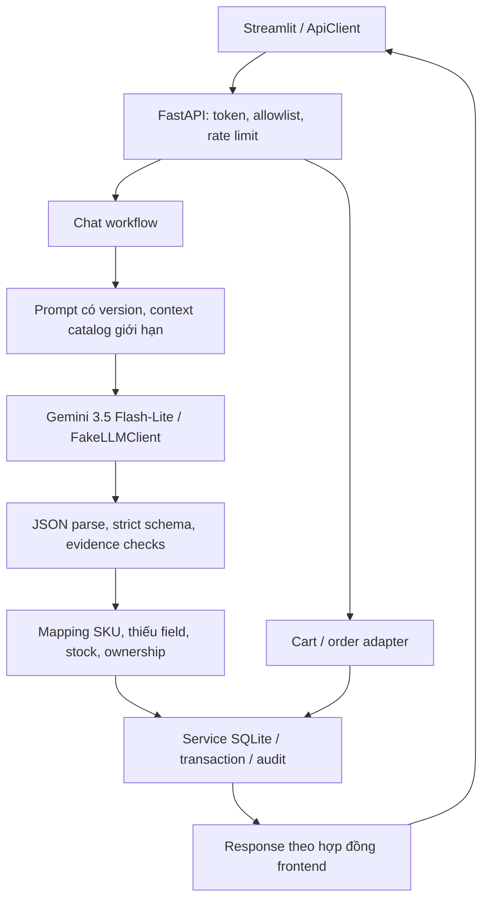

# Kiến trúc backend và LLM

## Phân chia code

| Thành phần | File | Quyết định |
|---|---|---|
| Cấu hình | `backend/config.py`, `.env.example` | Chọn fake/gemini; key chỉ từ môi trường; thiếu key ở gemini thì fail ngay |
| HTTP/API | `backend/main.py`, `backend/models.py` | Validate allowlist, token/TTL, rate limit, response lỗi không lộ input |
| Adapter domain | `backend/services.py` | Chuyển schema DB sang frontend; kiểm tra owner trước khi gọi service ghi |
| Phiên / receipt | `backend/storage.py` | Hash token, request hash, receipt cùng transaction với action |
| Chat state | `backend/chat_service.py` | Thu thập slot nhiều lượt, quyết định route, không đoán SKU/đơn mơ hồ |
| Catalog chat | `backend/catalog_chat.py` | Intent xem/tìm hàng, lọc giá/màu/size và trả thông tin thực từ DB; giữ ID/SKU vừa xem cho lượt sau |
| Prompt | `src/prompts.py` | Zero-shot `shop-assistant-v3`, system tách khỏi dữ liệu JSON có nhãn |
| Provider | `src/llm_client.py` | Gemini REST generateContent, x-goog-api-key header, timeout/retry hữu hạn; fake regex offline |
| Parser | `src/parser.py` | Chặn JSON lỗi, duplicate key, NaN, type/enum/field thừa, quantity bool; đối chiếu field với tin hiện tại |
| Database | `database/shop_db/` | Giữ nguyên schema/service hiện có; catalog/giá/tồn kho và transaction do DB service quyết định |

## Dữ liệu và trạng thái

Database hiện có schema v2, xem `database/docs/DATABASE.md`. Backend thêm hai bảng riêng bằng DDL idempotent khi startup:

- `api_sessions`: hash token, owner UUID, conversation ID, giỏ hiện tại, expiry.
- `api_receipts`: owner, scope, key, request hash và response; khóa chính tổng hợp chống replay tạo nhiều action.

Không sửa schema/service cũ để tích hợp frontend. Tạo giỏ lần đầu khi thêm item; lúc checkout, giỏ chuyển thành `pending_confirmation` trong transaction và session bỏ liên kết giỏ cũ. Chat tạo đơn nháp riêng nhưng dùng chung owner với đơn web. Startup chỉ seed catalog nếu trống, không reset đơn/tồn kho.

Chat dùng `conversations.context` để giữ item và giao nhận chưa hoàn tất. Chỉ merge các field mới có evidence; trường null không xóa slot đã thu thập. Khi đơn được tạo hoặc handoff, xóa slot đang chờ. Giá và stock không nằm trong JSON schema LLM. Khi hỏi giá/tồn kho giữa luồng đặt hàng, giữ ngữ cảnh đặt hàng để có thể tiếp tục.

`received/extracted/needs_information/stock_checked/pending_confirmation/handed_off/failed_validation` trong đề được biểu diễn bằng quá trình xử lý + route/audit, không thêm các trạng thái này vào bảng orders. `conversations.state` dùng enum đã có: `idle`, `collecting_info`, `awaiting_confirmation`, `handoff`. Order chỉ dùng vòng đời của database.

Provider call chạy trước transaction ghi để không khóa SQLite trong lúc đợi mạng. Sau đó, trong `BEGIN IMMEDIATE`, backend kiểm tra receipt và revision hội thoại trước khi áp dụng action. Nếu hai lượt khác nhau tính trên cùng context, lượt sau nhận 409; cùng key thì replay. Database service đảm bảo rollback khi cập nhật item/giao nhận thất bại.

## Prompt và Gemini

Mô hình hiện tại theo yêu cầu người dùng: `gemini-3.5-flash-lite`. Dùng [generateContent API](https://ai.google.dev/api/generate-content), structured schema trong `generationConfig.responseFormat.text`, JSON enum `APPLICATION_JSON`, `temperature=0`, giới hạn 2048 output token. Không bật tool, không thực thi code và không cho mô hình quyền gọi service ghi.

Context tối đa 6 sản phẩm liên quan, mỗi sản phẩm có alias và SKU/màu/size. Không gửi toàn bộ lịch sử hoặc giao nhận đã lưu sang provider ở lượt sau. Message tối đa 500 ký tự; JSON output tối đa 16.000 ký tự. Đây là giới hạn kích thước, không phải bộ đếm token chính xác. Token tiếng Việt và JSON vẫn tiêu thụ context; usage thực lấy từ `usageMetadata`, fake để null.

Mặc định không retry để giữ quota. Ngân sách ứng dụng hiện tại là 500 RPD cho Gemini 3.5 Flash-Lite theo thông tin người dùng; Gemini 3.6 Flash vẫn có trần cấu hình 20. Nếu bật, retry tối đa 2 lần sau lần đầu, chỉ timeout/network/429/5xx, backoff 0,25 rồi 0,5 giây. `Retry-After` dạng giây hoặc HTTP date được tôn trọng; nếu cần đợi trên 3 giây thì kết thúc request bằng lỗi có thể thử lại. 4xx, policy refusal, JSON/schema sai không retry. Các action DB không đi vào vòng lặp provider retry.

`src/quota.py` lưu số lần gọi ở SQLite riêng, transaction `BEGIN IMMEDIATE` giữ giới hạn giữa các phiên/process. Mỗi attempt được ghi trước network call, kể cả timeout/5xx; không hứa đếm giống hệt Google. Ngày reset theo Pacific Time. Không thể biết các lượt gọi trước khi có bộ đếm hoặc lượt gọi từ ứng dụng khác. Nhánh catalog local dùng rule chỉ cho các mẫu read-only rõ nghĩa và được gắn provenance riêng; không chạy FakeLLM như fallback ở chế độ Gemini.

## Log và dữ liệu cá nhân

`chat_processed` lưu timestamp, request ID, model ID, prompt version, intent, validation status, route, latency, token usage, retry count và error type trong audit. Không lưu raw prompt/output/evidence hay key vào audit. Tin user trong bảng messages được thay bằng nhãn intent; giao nhận cần cho luồng nhiều lượt chỉ nằm trong context/đơn/receipt có kiểm soát quyền. Assistant reply chứa thông tin catalog và hướng dẫn, không nhắc lại tên/SĐT/địa chỉ.

Log `shop.workflow` dùng cùng metadata; có thể cấu hình logging INFO khi vận hành. Lỗi bất ngờ chỉ log request ID và tên loại lỗi. Secret không xuất hiện trong URL request provider. Phiên/token chỉ dùng demo, không thay thế hệ thống tài khoản và chính sách retention cho production.

## Giới hạn bằng chứng

FakeLLM là rule-based, không sử dụng output từ expected test case để chọn câu trả lời. Các fixture lỗi chỉ chèn lỗi parser/provider để kiểm tra đường lỗi. `sample_results/evaluation_fake.*` là kiểm tra workflow có giới hạn. `sample_results/catalog_live_smoke.json` ghi kiểm tra luồng catalog bằng Gemini thật trên SQLite tạm. Cả hai không phải kết quả tổng quát hoặc bộ test độc lập do giảng viên chấm.
