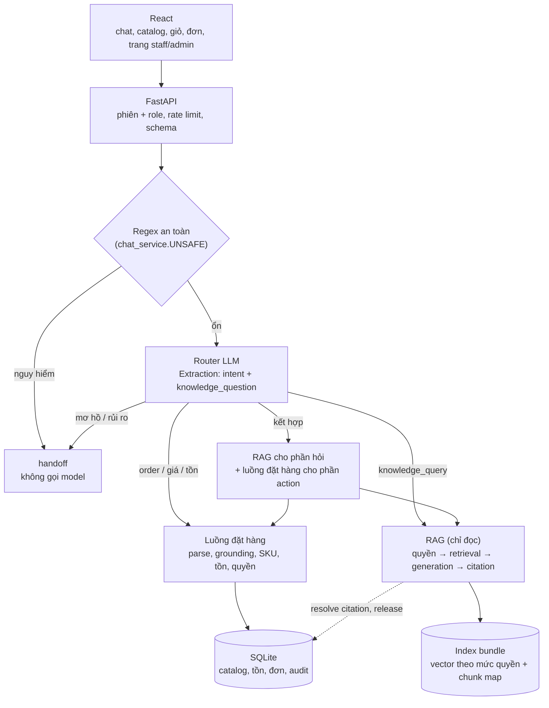

# Kiến trúc hệ thống

React gọi FastAPI; FastAPI định tuyến tin nhắn sang **luồng đặt hàng** (kế thừa từ project LLM), **luồng tra cứu tài liệu** (RAG, mới) hoặc **chuyển nhân viên**. Chỉ luồng đặt hàng được phép ghi đơn; RAG chỉ đọc.

## Route: quyền đọc, side effect, điểm validation

| Route | Đọc | Được ghi (side effect) | Validation bắt buộc |
|---|---|---|---|
| `create_order`, `update_order` | Catalog, tồn, đơn của phiên | Đơn nháp, dòng hàng, hội thoại, audit | Schema strict, grounding theo câu khách, SKU tồn tại duy nhất, số lượng do khách nêu, tồn kho, giao nhận, quyền sở hữu đơn, idempotency, kiểm tra lại phiên/revision trong transaction |
| `check_price`, `check_stock`, `browse_catalog` | Catalog, tồn | Chỉ hội thoại + audit | Grounding; giá/tồn đọc lại từ DB |
| `knowledge_query` (RAG) | Index đúng mức quyền của role, metadata corpus | Chỉ hội thoại + audit (chunk ID, status) | Quyền áp **trước** retrieval; citation phải thuộc context, resolve được tới file và version active; output JSON strict |
| Kết hợp | Như hai dòng trên | Chỉ phần order, qua đúng các validation của order | Kết quả RAG không bao giờ được truyền vào hàm có side effect; action chỉ chạy khi SKU/mã đơn/quyền đủ rõ |
| `handoff` | — | Hội thoại + audit | — |
| `/api/admin/reindex` | Manifest, bundle | Metadata corpus, con trỏ index | Chỉ role admin; bundle kiểm tra sha256 trước khi activate; đồng bộ DB và con trỏ cùng release |

## Thành phần

| Thành phần | Vị trí | Vai trò |
|---|---|---|
| UI | `frontend/src/App.tsx`, `Knowledge.tsx`, `AdminPage.tsx` | Chat có nhãn route, trạng thái, citation mở được nguồn; trang staff/admin |
| API | `backend/main.py`, `models.py`, `storage.py` | Endpoint, phiên + role mô phỏng, rate limit, idempotency |
| Router + order | `backend/chat_service.py`, `services.py`, `catalog_chat.py` | Điều phối hội thoại, tách phần kiến thức và phần action |
| LLM | `src/prompts.py`, `llm_client.py`, `parser.py` | Prompt `shop-assistant-v5` (thêm `knowledge_query`), Gemini/Fake, parse + grounding |
| RAG, retrieval (TV2) | `src/rag/gemini_index.py` | Kiểm tra corpus, chia đoạn theo heading, embedding Gemini 3072 chiều, index theo release, lọc quyền rồi `retrieve()`. Hợp đồng: `docs/rag_api_contract.md` |
| RAG, tích hợp (TV3) | `src/rag/`, `backend/knowledge_route.py` | `gemini_bundle` (adapter index TV2) hoặc bundle fake (`chunker`, `embedder`, `index`, `retriever`) → `answer` (generator) → `service` (quyền, ngưỡng context, cache, citation, re-index); `knowledge_route.answer_knowledge_question()` theo hợp đồng của TV2 |
| Dữ liệu corpus | `data_config/`, `database/shop_db/corpus_*.py`, `sku_sync_service.py` | Tài liệu Markdown, manifest release, metadata, đối soát SKU |
| Evaluation | `scripts/evaluate_rag.py`, `scripts/reindex_demo.py`, `artifacts/` | Metric RAG, kịch bản re-index |

## RAG pipeline

1. **Ingestion** (`scripts/build_index.py`): đọc manifest, kiểm tra đường dẫn, BOM/UTF-8, sha256, kích thước, front matter. Gemini (TV2): chia theo heading, đoạn dài cắt theo từ (900 ký tự, chồng 120), chunk ID `DOC-…:n`. Fake: mỗi section `##` một chunk, ID `DOC-…@version#nn`, có offset và SKU.
2. **Index** (`artifacts/index/<release>-<provider>/`). Gemini: `rag_index.json` (đoạn + vector) và `index_manifest.json` (model, số chiều, encoding, metric, chunk config, release, sha256 manifest corpus và index). Fake: một ma trận vector cho mỗi mức quyền + `chunks.jsonl` + `index_manifest.json`. Con trỏ active: `artifacts/index_manifest.json` (Gemini) hoặc `index_manifest_fake.json`. Index được kiểm tra một lần khi nạp (sha256, mapping, vector hợp lệ); lệch thì `degraded`.
3. **Quyền trước retrieval**: chỉ đoạn thuộc mức quyền của role được đưa vào xếp hạng (customer → `public`). Câu hỏi thuộc chủ đề nội bộ trả `access_denied` trước khi tạo candidate.
4. **Retrieval**: top-k cosine (Gemini: `retrieve()` của TV2; fake: numpy, cộng điểm khi câu hỏi nêu SKU). Sau đó lọc theo ngưỡng (Gemini 0,72, fake 0,12) và bảo đảm có chunk chính sách cho câu hỏi điều kiện nghiệp vụ. Điểm chỉ để xếp hạng/debug, không phải độ chắc chắn.
5. **Generation**: Gemini với prompt tách data/instruction (`src/rag/prompts.py`), hoặc generator extractive offline. Output `{status, answer, citations, missing_information}`.
6. **Kiểm tra citation**: mọi chunk được trích phải nằm trong context và resolve được tới file thật, đúng sha256, đúng version active; không thì hạ về `insufficient_evidence`/`error`.

## Phiên, role và tính nhất quán

`api_sessions` có thêm cột `role` (`customer` mặc định). Phiên `staff`/`admin` chỉ mở được khi gửi đúng khóa demo (`DEMO_STAFF_KEY`, `DEMO_ADMIN_KEY`); đây là role mô phỏng cho demo, không phải hệ thống đăng nhập. Lời gọi model (router và RAG) chạy **trước** transaction ghi; sau đó backend kiểm tra lại phiên, biên nhận idempotency và revision hội thoại. Cache câu trả lời RAG có key `index_id + role + câu hỏi` và bị xóa mỗi lần activate index.

## Cấu hình

`LLM_PROVIDER` (`fake`/`gemini`) chọn router và generator; `RAG_EMBEDDING_PROVIDER` (`fake`/`gemini`) chọn embedding và con trỏ index của provider đó (`artifacts/index_manifest.json` cho index Gemini của TV2, `artifacts/index_manifest_fake.json` cho fake). Ngưỡng context đi theo model embedding (Gemini 0,72, fake 0,12) vì điểm cosine của hai model không cùng thang. Lượt embedding câu hỏi được tính vào ngân sách gọi model hằng ngày như router và trả lời. Cấu hình chạy app: Gemini cho cả hai. Audit lưu route, intent, `rag_status`, chunk ID được trích, index_id, latency; không lưu nội dung context, khóa hay dữ liệu cá nhân.
