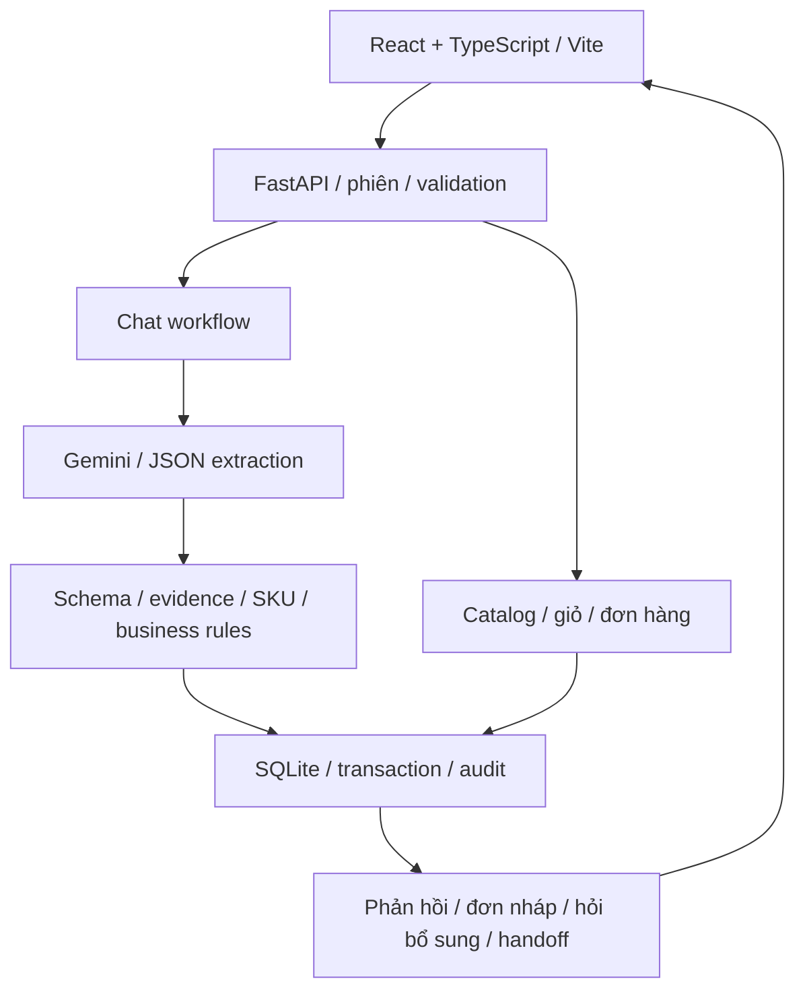

# Kiến trúc hệ thống

## Thành phần

| Thành phần | Vị trí | Vai trò |
|---|---|---|
| UI chính | `frontend/src/` | Catalog, giỏ, checkout, đơn hàng, chat |
| API | `backend/main.py`, `models.py` | Hợp đồng HTTP, token phiên, validation và rate limit |
| Nghiệp vụ | `backend/services.py`, `chat_service.py` | Điều phối đơn và hội thoại nhiều lượt |
| Catalog chat | `backend/catalog_chat.py` | Tìm sản phẩm, truy vấn giá/tồn từ DB |
| Prompt và provider | `src/prompts.py`, `llm_client.py` | Prompt `shop-assistant-v3`, Gemini REST và FakeLLM kiểm thử |
| Parser | `src/parser.py` | Kiểm tra JSON schema và căn cứ dữ liệu trích xuất |
| Database | `database/shop_db/` | Catalog, inventory, orders, conversations và audit |
| Evaluation | `scripts/evaluate.py`, `review_evaluation.py` | Chạy case và hỗ trợ chấm rubric 0/1/2 |

## Luồng đặt hàng

1. Web/chat gửi yêu cầu kèm token phiên tới API.
2. Với chat, workflow tiếp nhận tin nhắn và ngữ cảnh; LLM trả intent và JSON có cấu trúc.
3. Backend kiểm tra field, SKU, số lượng, tồn kho và quyền sở hữu. Giá/tổng tiền lấy từ database.
4. Thông tin đủ thì tạo/sửa đơn nháp; thiếu thông tin thì hỏi bổ sung; yêu cầu cần hỗ trợ được chuyển `handoff`.
5. Transaction lưu đơn, receipt và audit. Phản hồi trả về UI cùng mã đơn/trạng thái.

## Phiên và tính nhất quán

`api_sessions` liên kết phiên với owner, giỏ và hội thoại; `api_receipts` lưu idempotency key cùng response. Context hội thoại giữ thông tin đã thu thập qua nhiều lượt. Khi cập nhật, backend đối chiếu revision, quyền và tồn kho trong transaction. Provider call thực hiện trước transaction ghi.

## Cấu hình và vận hành

Provider/model/timeout/retry được cấu hình qua `.env`. `LLM_PROVIDER=gemini` dùng API key từ biến môi trường; `fake` là chế độ offline riêng để tái chạy workflow. Audit lưu metadata như prompt/model, intent, route, latency và loại lỗi. Vite proxy `/api` đến FastAPI; frontend không truy cập SQLite trực tiếp.
