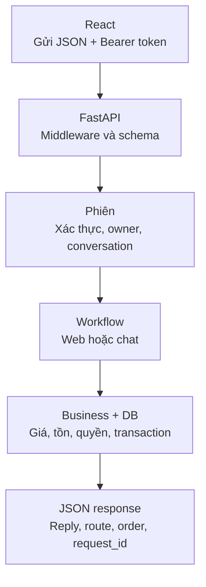
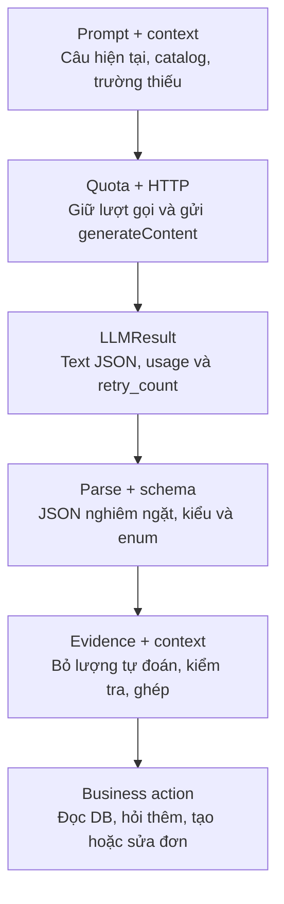

# Backend và xử lý LLM — bản ngắn

Nội dung tương ứng bản PowerPoint 12 slide, dùng cho phần trình bày khoảng 10–15 phút.
Code đối chiếu ngày 22/10/2026. Các khối code là đoạn trích; tên file và dải dòng nằm ngay phía trên.

## 1. Backend và xử lý LLM

Theo dõi một yêu cầu đặt balo từ lúc frontend gửi request, qua Gemini hiểu câu khách, đến khi backend tạo đơn trong database.

**Vai trò chính:** Gemini trích xuất ý định và thông tin. Backend kiểm tra và quyết định hành động. Database cung cấp giá, tồn kho và lưu đơn.

---

## 2. Pipeline chung của backend



Catalog là dữ liệu công khai. Giỏ hàng, đơn hàng và chat cần phiên hợp lệ. Luồng đặt hàng từ form web gọi service trực tiếp; luồng chat có thêm bước hiểu ngôn ngữ.

**Nguồn:** [backend/main.py](</Users/mac/Intern FSOFT/projects/miniproject4/LLM-mini-project/backend/main.py>), [backend/services.py](</Users/mac/Intern FSOFT/projects/miniproject4/LLM-mini-project/backend/services.py>), [backend/chat_service.py](</Users/mac/Intern FSOFT/projects/miniproject4/LLM-mini-project/backend/chat_service.py>).

---

## 3. Nơi nhận request chat

Endpoint POST /api/chat chuyển body.message sang workflow sau khi xác thực phiên.

`chat_message()` là điểm vào HTTP. `ChatRequest` kiểm tra body, `session_db()` xác thực phiên và cung cấp kết nối DB. `request_key()` đọc khóa chống gửi trùng, còn `limiter.check()` giới hạn lượt chat theo chủ phiên. Hàm chuyển tin nhắn sang `chat()` để xử lý nghiệp vụ.

**Code chứng minh:** [backend/main.py:237–244](</Users/mac/Intern FSOFT/projects/miniproject4/LLM-mini-project/backend/main.py:237>)

```python
    @app.post("/api/chat")
    # Nhận tin nhắn, kiểm tra phiên/giới hạn gọi chat rồi chuyển sang luồng xử lý bot.
    def chat_message(body: ChatRequest, request: Request):
        key = request_key(request.headers.get("Idempotency-Key"))
        with session_db(request) as (conn, session, ctx):
            limiter.check("chat", session["owner_id"], settings.chat_limit)
            return chat(conn, ctx, session, body.message, app.state.llm_client, key)

```

**Ý chính:** chat_message() là điểm vào HTTP, chat() là bộ điều phối nghiệp vụ.

---

## 4. Ngữ cảnh gửi cho model

Backend chọn sản phẩm liên quan từ DB, rồi ghép câu khách và context thành prompt.

`_catalog_context()` truy vấn sản phẩm liên quan trong database. `build_prompt()` ghép tin nhắn hiện tại, catalog rút gọn và context hội thoại thành JSON. System prompt yêu cầu model trả dữ liệu có cấu trúc như `intent`, `items`, `customer`, `evidence`. Backend dùng context để tiếp tục yêu cầu còn thiếu thông tin.

**Code chứng minh:** [src/prompts.py:48–54](</Users/mac/Intern FSOFT/projects/miniproject4/LLM-mini-project/src/prompts.py:48>)

```python
def build_prompt(message, catalog, context):
    safe_context = {"pending_intent": context.get("pending_intent"),
                    "pending_items": context.get("items", []),
                    "recent_products": context.get("recent_products", [])}
    payload = {"CUSTOMER_MESSAGE": message, "CATALOG_CONTEXT": catalog,
               "CONVERSATION_CONTEXT": safe_context, "OUTPUT_SCHEMA": Extraction.model_json_schema()}
    return SYSTEM_PROMPT, json.dumps(payload, ensure_ascii=False)
```

**Ý chính:** pending_items giúp hiểu câu tiếp, còn server chịu trách nhiệm gộp trường.

Phần lấy sản phẩm từ DB: [backend/chat_service.py:45–57](</Users/mac/Intern FSOFT/projects/miniproject4/LLM-mini-project/backend/chat_service.py:45>). Quy tắc prompt: [src/prompts.py:7–44](</Users/mac/Intern FSOFT/projects/miniproject4/LLM-mini-project/src/prompts.py:7>).

---

## 5. Pipeline xử lý LLM



Đây là nhánh xử lý qua Gemini. Các câu catalog rõ nghĩa có thể được rule xử lý mà không gọi model. `generate()` trả `LLMResult`; workflow tiếp tục kiểm tra dữ liệu và chọn hành động. Mọi thao tác ghi đơn phải qua kiểm tra nghiệp vụ.

**Nguồn:** [src/prompts.py](</Users/mac/Intern FSOFT/projects/miniproject4/LLM-mini-project/src/prompts.py>), [src/llm_client.py](</Users/mac/Intern FSOFT/projects/miniproject4/LLM-mini-project/src/llm_client.py>), [src/parser.py](</Users/mac/Intern FSOFT/projects/miniproject4/LLM-mini-project/src/parser.py>), [backend/chat_service.py](</Users/mac/Intern FSOFT/projects/miniproject4/LLM-mini-project/backend/chat_service.py>).

---

## 6. Gọi Gemini qua REST

GeminiLLMClient.generate() ghép payload rồi gọi endpoint generateContent.

`GeminiLLMClient.generate()` dựng payload, giữ một lượt trong ngân sách ngày rồi gửi HTTP đến `generateContent`. API key lấy từ cấu hình. Hàm trả `LLMResult` chứa văn bản JSON, token usage và số lần retry. Timeout, lỗi provider hoặc hết ngân sách được chuyển thành lỗi để workflow xử lý.

**Code chứng minh:** [src/llm_client.py:51–57](</Users/mac/Intern FSOFT/projects/miniproject4/LLM-mini-project/src/llm_client.py:51>)

```python
        system, prompt = build_prompt(message, catalog, context)
        url = "https://generativelanguage.googleapis.com/v1beta/models/" + quote(self.model_id, safe="-") + ":generateContent"
        payload = {"systemInstruction": {"parts": [{"text": system}]},
                   "contents": [{"role": "user", "parts": [{"text": prompt}]}],
                   "generationConfig": {"temperature": 0, "maxOutputTokens": 2048,
                                        "responseFormat": {"text": {"mimeType": "APPLICATION_JSON",
                                                                    "schema": Extraction.model_json_schema()}}}}
```

**Code chứng minh:** [src/llm_client.py:66–67](</Users/mac/Intern FSOFT/projects/miniproject4/LLM-mini-project/src/llm_client.py:66>)

```python
                response = requests.post(url, headers={"x-goog-api-key": self.settings.api_key}, json=payload,
                                         timeout=self.settings.llm_timeout, allow_redirects=False)
```

**Ý chính:** temperature=0, maxOutputTokens=2048 và responseFormat yêu cầu JSON theo schema.

Bộ đếm ngân sách nằm tại [src/quota.py:22–32](</Users/mac/Intern FSOFT/projects/miniproject4/LLM-mini-project/src/quota.py:22>). Giới hạn cấu hình trong ứng dụng có thể khác quota thực tế của provider.

---

## 7. Kiểm tra kết quả LLM

Workflow parse JSON, kiểm tra schema và đối chiếu trường trích xuất với câu khách.

`parse_output()` kiểm tra JSON và dùng Pydantic để tạo `Extraction`. `discard_implicit_quantities()` bỏ số lượng model tự điền khi khách chưa nêu. `validate_grounding()` đối chiếu các trường trích xuất với chính tin nhắn hiện tại. Kết quả chỉ được ghép vào context sau các bước kiểm tra này. Lỗi provider/output dẫn tới `failed_validation`, đơn hàng chưa thay đổi.

**Code chứng minh:** [backend/chat_service.py:237–241](</Users/mac/Intern FSOFT/projects/miniproject4/LLM-mini-project/backend/chat_service.py:237>)

```python
            llm = client.generate(message, _catalog_context(conn, message, context), context)
            meta.update(input_tokens=llm.input_tokens, output_tokens=llm.output_tokens, retry_count=llm.retry_count)
            parsed = parse_output(llm.text)
            quantities = [item.quantity for item in parsed.items]
            data = validate_grounding(discard_implicit_quantities(parsed, message), message)
```

**Code chứng minh:** [src/parser.py:75–78](</Users/mac/Intern FSOFT/projects/miniproject4/LLM-mini-project/src/parser.py:75>)

```python
    try:
        return Extraction.model_validate(value)
    except ValidationError:
        raise OutputError("invalid_schema") from None
```

**Ý chính:** Dữ liệu hợp schema còn phải qua grounding, đối chiếu SKU, tồn kho và quyền phiên.

Phần kiểm tra grounding đầy đủ: [src/parser.py:127–163](</Users/mac/Intern FSOFT/projects/miniproject4/LLM-mini-project/src/parser.py:127>).

---

## 8. Ví dụ: 15inch không phải số lượng 15

Khách chưa nêu số lượng thì backend bỏ lượng model tự đoán và hỏi lại.

`quantity_source()` loại số đo, SKU và phần giao nhận khỏi nguồn kiểm tra số lượng. Nếu khách chưa nêu lượng rõ ràng, `discard_implicit_quantities()` đưa `quantity` về `None`. Bot trả `ask_missing` để hỏi thêm. Khi khách bổ sung, `_merge_items()` ghép dữ liệu mới với sản phẩm đã chọn.

**Code chứng minh:** [src/parser.py:118–124](</Users/mac/Intern FSOFT/projects/miniproject4/LLM-mini-project/src/parser.py:118>)

```python
def discard_implicit_quantities(data, message):
    source = quantity_source(message, data.customer)
    explicit = " invalidquantity " in source or re.search(r"\b\d+\b", source) or any(" " + word + " " in source for word in NUMBER_WORDS)
    if data.intent in {"create_order", "update_order"} and not explicit:
        for item in data.items:
            item.quantity = None
    return data
```

**Code chứng minh:** [src/prompts.py:28–29](</Users/mac/Intern FSOFT/projects/miniproject4/LLM-mini-project/src/prompts.py:28>)

```text
An instruction to order a product without a count must have quantity=null, never default 1.
Measurements such as 15inch/15 inch describe size, never quantity. Keep their literal spelling.
```

**Ý chính:** “Đặt balo xám 15inch” còn thiếu quantity. Khách bổ sung số lượng rồi mới tạo đơn.

Ví dụ: “Đặt balo xám 15inch” xác định kích thước 15 inch nhưng còn thiếu số lượng. Khách cần bổ sung, chẳng hạn “2 cái”, cùng thông tin giao nhận còn thiếu.

---

## 9. Chọn nhánh nghiệp vụ

Workflow quyết định action từ intent đã qua kiểm tra và dữ liệu đã ghép.

`chat()` chọn hành động theo intent đã kiểm tra: `browse_catalog` gọi `catalog_reply()`, `create_order` gọi `_draft()`, `update_order` gọi `_update()`, còn câu hỏi giá/tồn đi qua `_query()`. Nếu độ tin cậy thấp hoặc yêu cầu cần người xem lại, workflow chuyển `handoff` trước đoạn dispatch này.

**Code chứng minh:** [backend/chat_service.py:283–290](</Users/mac/Intern FSOFT/projects/miniproject4/LLM-mini-project/backend/chat_service.py:283>)

```python
                if data.intent == "browse_catalog":
                    result = catalog_reply(conn, incoming, data.catalog_filters, data.intent)
                elif data.intent == "create_order":
                    result = _draft(conn, ctx, session, slots, key)
                elif data.intent == "update_order":
                    result = _update(conn, ctx, session, slots)
                else:
                    result = _query(conn, slots["items"], data.intent, data.catalog_filters)
```

**Ý chính:** Model đưa ra Extraction, Python chọn hành động và dữ liệu database quyết định kết quả.

---

## 10. Tạo đơn nháp qua bot

_draft() kiểm tra số lượng, giao nhận và tồn kho rồi gọi order service.

`_draft()` đối chiếu sản phẩm/biến thể, kiểm tra số lượng và giao nhận. Thiếu dữ liệu thì bot hỏi tiếp. Đủ dữ liệu thì backend kiểm tra tồn và gọi `orders.create_draft_order()`. Giá và nhãn sản phẩm lấy từ database. Khóa idempotency giúp tránh tạo trùng khi gửi lại cùng request.

**Code chứng minh:** [backend/chat_service.py:149–156](</Users/mac/Intern FSOFT/projects/miniproject4/LLM-mini-project/backend/chat_service.py:149>)

```python
    resolved = [{"sku": s, "quantity": q} for s, q in normalize_items(resolved)]
    stock = catalog.check_items(conn, resolved)
    if not stock["ok"]:
        details = "; ".join(f"{r['sku']} còn {r['available']}, bạn yêu cầu {r['requested']}" for r in stock["results"] if not r["ok"])
        return response("Không đủ hàng: " + details + ". Vui lòng chọn lại số lượng hoặc biến thể.", "out_of_stock")
    order = orders.create_draft_order(conn, ctx, session["owner_id"], resolved, delivery, source="chat", idempotency_key=key)
    return response("Đã tạo đơn nháp. Bạn có thể xem và sửa ở trang Đơn hàng; đơn đang chờ xác nhận.",
                    "draft_created", order=order_view(conn, order))
```

**Ý chính:** Đơn có source=chat, chờ xác nhận. Kho chưa bị trừ ở bước tạo đơn nháp.

---

## 11. Giá tiền và trạng thái đơn trong DB

Lớp dữ liệu kiểm tra hàng/giao nhận và chuyển đơn sang pending_confirmation trong transaction.

`create_draft_order()` tạo các dòng hàng và chuyển đơn sang `pending_confirmation` trong transaction. `recalc_total()` tính tổng từ `line_total` đã lưu. Lời gọi Gemini diễn ra trước transaction ghi; sau khi model trả, backend kiểm tra lại phiên và revision hội thoại trước khi thay đổi dữ liệu. Lỗi giữa transaction sẽ rollback.

**Code chứng minh:** [database/shop_db/order_service.py:128](</Users/mac/Intern FSOFT/projects/miniproject4/LLM-mini-project/database/shop_db/order_service.py:128>)

```python
    with transaction(conn):
```

**Code chứng minh:** [database/shop_db/order_service.py:132](</Users/mac/Intern FSOFT/projects/miniproject4/LLM-mini-project/database/shop_db/order_service.py:132>)

```python
        order = create_cart(conn, ctx, owner, items, source)
```

**Code chứng minh:** [database/shop_db/order_service.py:138–140](</Users/mac/Intern FSOFT/projects/miniproject4/LLM-mini-project/database/shop_db/order_service.py:138>)

```python
        order = change_status(conn, ctx, order["id"], "pending_confirmation")
        order["replayed"] = False
        return order
```

**Code chứng minh:** [database/shop_db/order_common.py:36–40](</Users/mac/Intern FSOFT/projects/miniproject4/LLM-mini-project/database/shop_db/order_common.py:36>)

```python
def recalc_total(conn, order_id) -> int:
    total = conn.execute("SELECT COALESCE(SUM(line_total), 0) FROM order_items WHERE order_id = ?",
                         (order_id,)).fetchone()[0]
    conn.execute(f"UPDATE orders SET total_amount = ?, updated_at = {NOW_SQL} WHERE id = ?", (total, order_id))
    return total
```

**Ý chính:** line_total và tổng đơn do server tính, không lấy một con số model sinh ra.

Đoạn kiểm tra lại phiên và hội thoại: [backend/chat_service.py:255–265](</Users/mac/Intern FSOFT/projects/miniproject4/LLM-mini-project/backend/chat_service.py:255>).

---

## 12. Ví dụ balo đã chạy bằng Gemini thật

1. Câu đầu: “đặt cho tôi balo laptop Balo laptop xám, 15inch”
2. Route đầu: ask_missing, đúng BAG-GRY-15, giá 520.000₫, tồn 4
3. Bổ sung số lượng 2 và giao nhận demo ngay trong chat
4. Route sau: draft_created, tổng 1.040.000₫, source=chat
5. Đơn chờ xác nhận, tồn sau kiểm tra vẫn 4

**Tổng tiền:** `2 × 520.000 = 1.040.000 VND`.

Đây là kết quả Gemini thật đã lưu ngày 22/10/2026 trên database thử riêng. Đơn có trạng thái chờ xác nhận; tồn kho vẫn là 4. Không phát sinh lời gọi Gemini mới khi chuyển tài liệu này sang Markdown.

**Bằng chứng:** [sample_results/chat_purchase_2026-10-22/live_gemini_order.json](</Users/mac/Intern FSOFT/projects/miniproject4/LLM-mini-project/sample_results/chat_purchase_2026-10-22/live_gemini_order.json>).

**Giới hạn khi trình bày:** Bản demo dùng phiên có thời hạn và rate limiter trong RAM của một process. Kiểm tra chuỗi/evidence chưa bảo đảm hiểu mọi cách nói. Lượt demo trực tiếp còn phụ thuộc mạng và quota.
